<div align="center">

# 🏠 像素小屋 · DollHouse

**一个可以放在口袋里的像素小人之家**

小人们会在房子里自己生活：上班上学、吃饭睡觉、弹琴打游戏、交朋友、谈恋爱……偶尔还会闹出点狗血剧情。
你负责布置房间、给他们换衣服，偶尔把谁拎起来换个地方。

### [▶️ 在线试玩](https://aubreykuang.github.io/DollHouse/)

<sub>打开就能玩，电脑和手机都可以</sub>

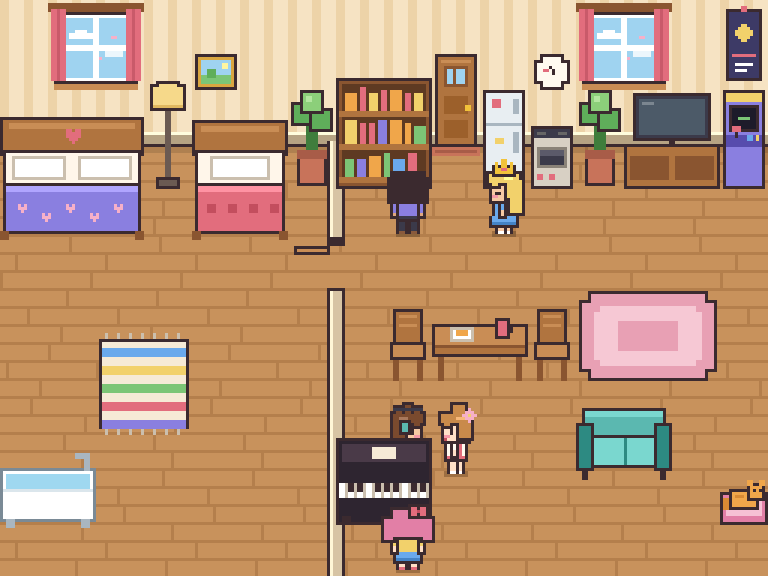

<sub>☝️ 小桃弹起了钢琴，大家陆续围过来听，有人跟着跳起舞</sub>

<br>


</div>

---

## ✨ 零素材：一切都是代码现场画出来的

游戏里**没有一张图片、一个 3D 模型、一段音频**。

- 🎨 **画面**：墙纸、地板、33 种家具，还有每个小人的发型、衣服、配饰，都是打开网页后用 Canvas 一个像素一个像素画出来的
- 🔊 **声音**：放家具的"咚"、吃零食的"咔嚓"、弹琴的音符、猫叫声和背景音乐，全部用 WebAudio 振荡器和噪声现场合成
- 🌗 **光影**：天色随时间变化，入夜后房间变暗，台灯、电视、彩灯、圣诞树会发出暖光
- 🌧 **天气**：窗外的雨丝、雪花、春天的花瓣、秋天的落叶都是一颗颗像素算出来的；下雨时还有合成的雨声

整个游戏打包后是一个约 165KB 的 HTML 文件。双击就能玩，不用联网，也不用安装任何东西。

> README 里的截图和动图只是为了展示效果，是用无头浏览器对游戏画面截的屏，游戏本身用不到它们。

---

## 🎮 玩法一览

<table>
<tr>
<td width="50%" valign="top">

### 🏠 生活
小人有**精力、饱腹、快乐、社交**四项需求，会根据需求和性格自己决定下一步做什么。

- 点击小人：查看状态卡、摸摸头
- 按住拖动：把小人**拎起来**放到别处
- 选中小人后点家具：让 TA 去用那件家具

</td>
<td width="50%" valign="top">

### 🪑 布置
- 33 种家具：双人床、咖啡机、鱼缸、电脑桌、音响、画架、跑步机、圣诞树、灯笼……
- 房子分成 **卧室** 和 **客厅**，中间的门可以开关（生活模式下点门）
- 新家具要用 **🏦 家庭基金** 买，删掉的家具收进仓库，可以再拿出来
- **🔨 扩建**房子会真的变宽，并解锁更多家具
- 大门可以挪位置，但不能拆（大家要出门的嘛）
- 点已有家具可以**拿起来移动**
- 8 种墙纸、6 种地板随意搭配
- 放好的家具，小人马上就会去用

</td>
</tr>
<tr>
<td valign="top">

### 👗 衣橱
- 5 种肤色 · 6 种发型 · 10 种发色
- 6 种上衣 · 3 种下装 · 12 种衣服颜色
- 7 种配饰：鸭舌帽、蝴蝶结、眼镜、耳机、猫耳、小花、王冠……
- 一键 🎲 随机搭配，可以改名、改性格、职业、性别和感情观

</td>
<td valign="top">

### 💞 人际关系
- 每对小人之间都有 **🤝 友好度** 和 **💗 恋爱度**
- 关系会从 陌生 → 认识 → 朋友 → 好友 → 挚友 慢慢发展
- 合得来的会心动、表白，表白成功就成为 **💕 恋人**
- 恋人晚上会叫对方一起睡 **双人床**，睡着时还会冒 💕
- 看到恋人和别人抱在一起会 **😤 吃醋**，然后过去找 TA 算账
- **花心**的人有了对象还会偷偷撩别人，被撞见就要吵架、分手 💔
- 卧室有双人床又没人时，花心的人会把暧昧对象叫进卧室、**关上门**——门外的恋人看不见，但要是推门进来……
- 合不来的会吵架，严重时会闹翻，恋人也可能分手

</td>
</tr>
</table>

<table>
<tr>
<td width="50%" valign="top">

### 💼 职业与作息
每个人都有职业，到点会从大门出门，下班再回来：

| 职业 | 时间 | 休息 |
|---|---|---|
| 🎒 学生 | 08:00–16:00 | 周末（不参与恋爱剧情） |
| 💼 上班族 | 09:00–18:00 | 周末 |
| 🥐 面包师 | 05:30–13:00 | 周一 |
| ☕ 咖啡师 | 10:00–19:00 | 周三 |
| 🌙 夜班店员 | 22:00–06:00 | 周日 |
| 🎨 自由画家 / 🏠 宅在家 | 不出门 | — |

每天回家的时间都会浮动一点，偶尔早退，偶尔加班到很晚。
到家时大家会说"欢迎回来"，恋人会跑过来抱一下。

**💰 收入与储蓄**：下班到家领日薪（上班族 ¥320、夜班 ¥280、面包师 ¥240、咖啡师 ¥210，加班多拿 50%），学生有 ¥40 零花钱，自由画家偶尔卖画；宅在家的没有收入。
吃零食 ¥12、买菜做饭 ¥25，每晚 0 点交房租水电 ¥50（学生不用交）。钱不够时，恋人或好朋友会帮忙付；没人帮就只能饿着。

</td>
<td width="50%" valign="top">

### 🎭 开局的故事
一打开游戏，屋里就已经有一段关系网：

- 🍙 **团子**（专一）和 💤 **阿懒**（花心）是一对恋人
- 阿懒对 ⚡ **小桃**（咖啡师）也有点意思……
- 📚 **眼镜君**（专一）在暗恋小桃

团子是面包师，每天一大早出门挣钱；阿懒宅在家里，存款只有 ¥180，很快就得靠团子养。
接下来是阿懒移情别恋、团子撞破，还是小桃和眼镜君修成正果？每一局都不一样。

</td>
</tr>
</table>

---

## 📸 截图

<table>
<tr>
<td width="50%">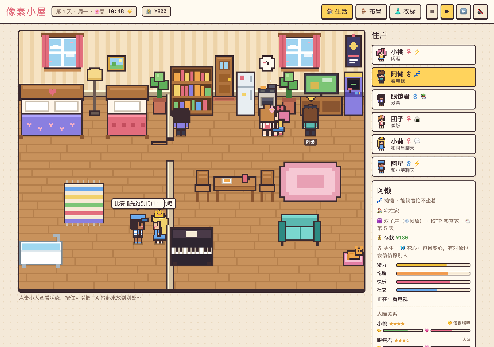<br><sub><b>白天</b> · 选中阿懒：他和团子是恋人，却和小桃"偷偷暧昧"</sub></td>
<td width="50%">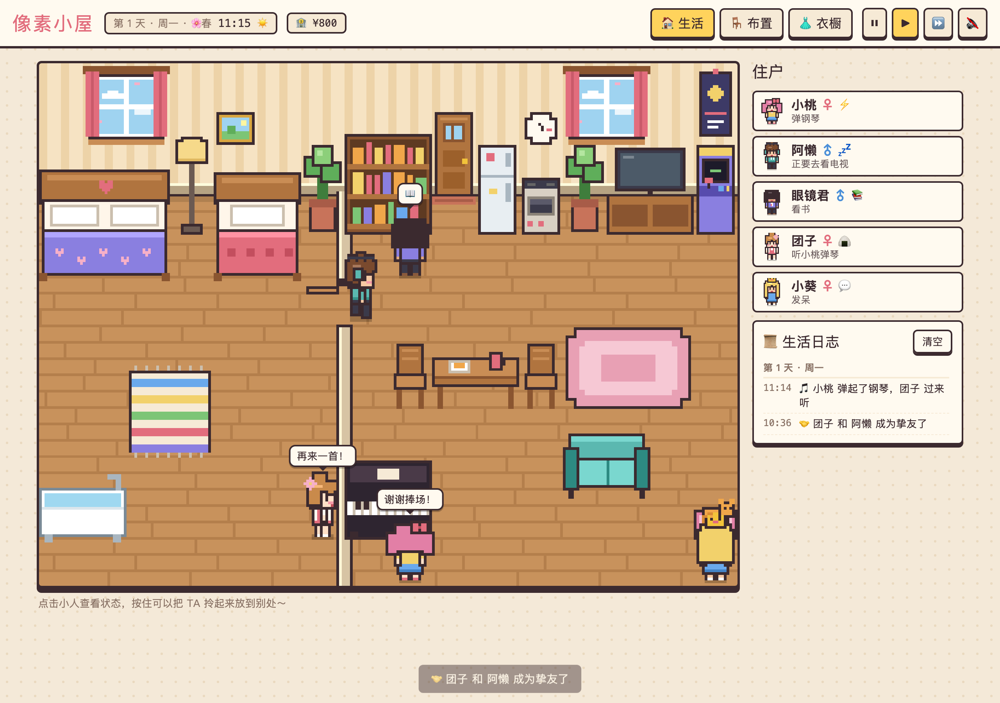<br><sub><b>围观</b> · 有人弹琴时，其他人会凑过来听，演奏者会说"谢谢捧场"</sub></td>
</tr>
<tr>
<td width="50%">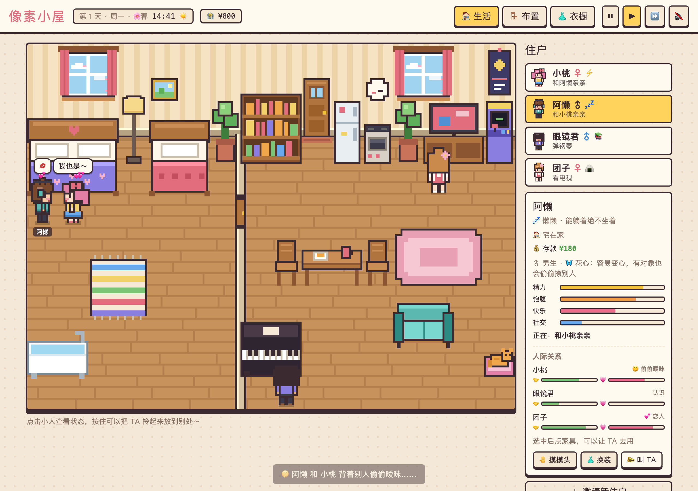<br><sub><b>关上门</b> · 团子在客厅看电视，阿懒把小桃叫进了卧室……</sub></td>
<td width="50%">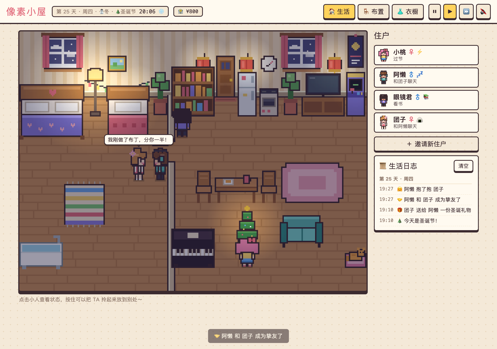<br><sub><b>圣诞雪夜</b> · 窗外下雪，挂上灯笼和圣诞树，大家互送礼物</sub></td>
</tr>
<tr>
<td width="50%">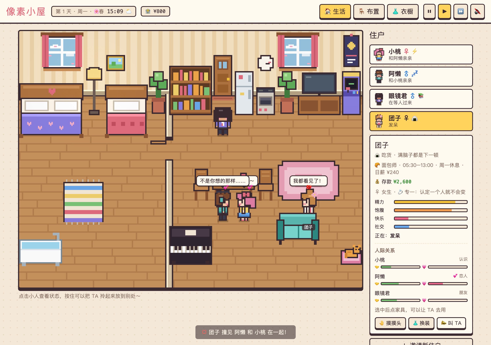<br><sub><b>修罗场</b> · 团子撞见阿懒和小桃亲亲："我都看见了！"</sub></td>
<td width="50%">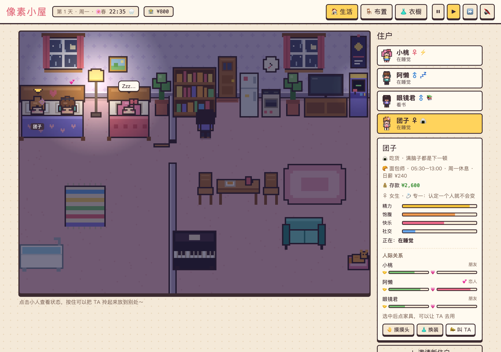<br><sub><b>同床共枕</b> · 团子躺上双人床，叫恋人阿懒一起睡</sub></td>
</tr>
<tr>
<td colspan="2">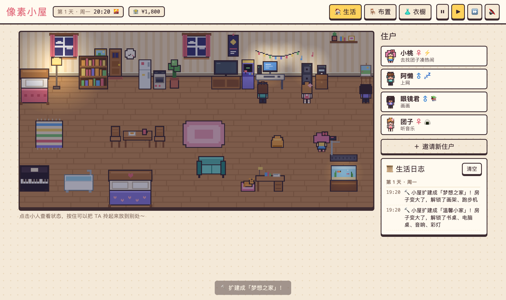<br><sub><b>梦想之家</b> · 扩建两次后房子宽了一半：彩灯、电脑桌、音响、画架、跑步机、鱼缸……团子放起音乐，小桃跑过来跳舞</sub></td>
</tr>
<tr>
<td colspan="2">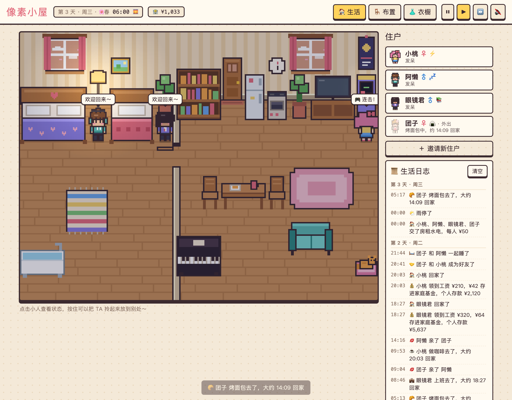<br><sub><b>生活日志</b> · 像模拟人生一样，按天记下谁几点出门、领了多少工资、和谁亲亲、交了房租……</sub></td>
</tr>
<tr>
<td>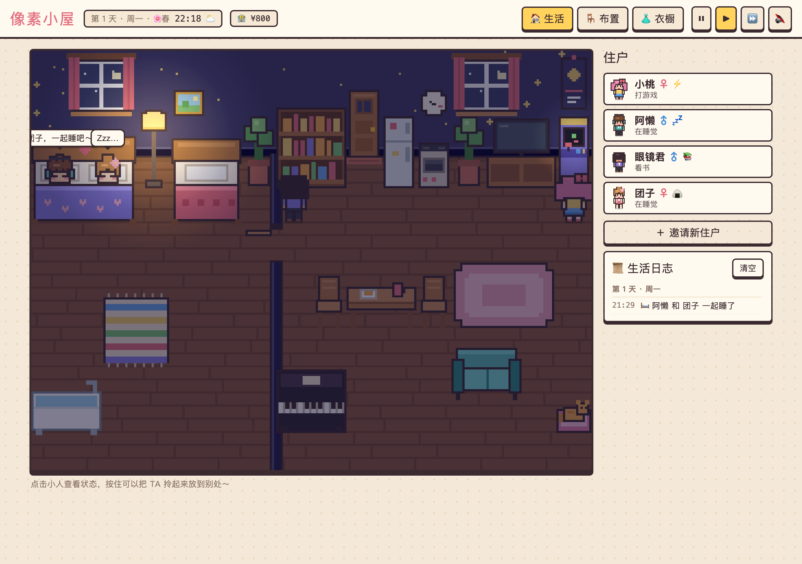<br><sub><b>夜晚</b> · 星空墙纸配胡桃木地板，台灯点亮，有人已经睡着了</sub></td>
<td>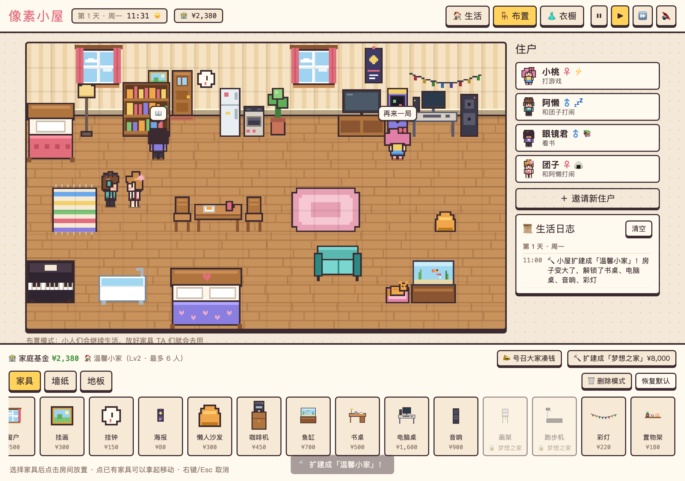<br><sub><b>商店</b> · 用家庭基金买家具，带锁的要扩建后才能买</sub></td>
</tr>
<tr>
<td>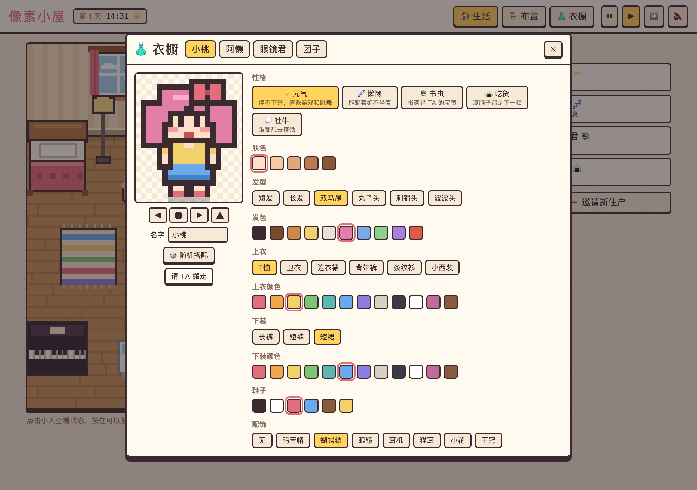<br><sub><b>衣橱</b> · 性格、职业、性别、感情观和穿搭都在这里改</sub></td>
<td align="center">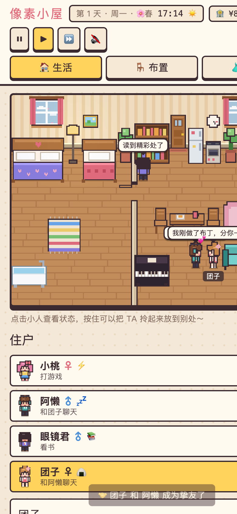<br><sub><b>手机</b> · 支持触屏，手指按住就能拎起小人</sub></td>
</tr>
</table>

---

## 🧸 五种性格

| 性格 | 特点 | 喜欢 |
|:---:|---|---|
| ⚡ **元气** | 走路最快，坐不住，看书坐沙发都只待一会儿；不爱睡觉 | 打游戏、跳舞 |
| 💤 **懒懒** | 走路最慢，一坐就是很久，还会站着打盹；讨厌跳舞 | 睡觉、窝沙发、看电视、泡澡 |
| 📚 **书虫** | 一看书就停不下来，很少主动找人聊天 | 看书、弹琴、浇花 |
| 🍙 **吃货** | 饿得特别快，吃起来没完 | 翻冰箱、做饭、蹭别人的饭 |
| 💬 **社牛** | 一会儿不说话就寂寞，聊起来没完 | 找人聊天、拥抱、撸猫 |

每种性格还有自己的口头禅：元气会喊"比赛谁先跑到门口！"，懒懒聊着聊着就"zzz"，书虫张口就是"你知道吗，章鱼有三颗心脏"。

## ♈ 星座与 MBTI

每个小人还有星座和 MBTI。它们不会推翻性格，只在性格的打分上再做加减，所以两个同样"元气"的人也会过得很不一样。

| | 影响 |
|---|---|
| **E / I** | 外向的人社交需求掉得快、更爱聊天和凑热闹；内向的人更爱看书、看鱼、上网，聊完天会有点累 |
| **S / N** | 实感型偏爱做饭、跑步、浇花；直觉型偏爱看书、画画、弹琴、上网 |
| **T / F** | 情感型更容易心动、被背叛时更受伤；两个思考型吵完架不太记仇 |
| **J / P** | 判断型做事专注、上班准时；感知型爱闲逛、更随性，上班常常踩点 |
| 🔥🌍💨💧 **星座元素** | 火象爱玩（跳舞、游戏、运动），土象务实（做饭、学习），风象爱交流（聊天、上网、音乐），水象敏感（泡澡、钢琴、画画），吃醋更厉害 |
| 💞 **缘分** | 同元素、互补元素（火配风、土配水）缘分高，对冲元素（火配水、风配土）缘分低；MBTI 的"黄金搭档"（如 INTJ × ENFP）再加成。缘分越高，关系涨得越快、表白越容易成功。人际关系里用 ★ 显示 |
| 🎂 **生日** | 每个星座对应一年里的一天。生日那天全家庆祝，关系好的人会送礼物 |

开局的四个人：小桃 ♈ ENFP、阿懒 ♊ ISTP、眼镜君 ♒ INTJ、团子 ♉ ISFJ。
阿懒和团子（风象 × 土象）缘分只有 ★★，阿懒和小桃（风象 × 火象）却是 ★★★★；眼镜君和小桃是 INTJ × ENFP 的黄金搭档。

实测：两个都是"元气"、需求完全相同的人，ENFP 白羊座 4 天里主动聊天 74 次，ISTJ 金牛座只有 11 次，更多是自己跳舞。

## 💘 感情观

| | 有对象之后 |
|:---:|---|
| 💍 **专一** | 感情会越来越深；别人示好会直接拒绝："我已经有对象了！" |
| 🙂 **普通** | 顺其自然，偶尔动摇 |
| 🎒 **学生** | 不管感情观是什么，职业是学生的人只交朋友：不会表白、亲亲、暧昧、偷情，也不会成为谁的恋人 |
| 🦋 **花心** | 对恋人的感情会慢慢变淡；会偷偷撩别人，恋人去上班时更大胆。被恋人撞见就吵架甚至分手；新欢比旧爱更喜欢时，会直接甩掉旧爱 |

## 💬 小人之间会发生的事

| 互动 | 什么时候发生 | 效果 |
|---|---|---|
| 聊天 / 打闹 | 随时 | 友好度上升；熟了以后会慢慢心动 |
| 🤗 抱抱 | 友好度够高 | 友好度和恋爱度都上升 |
| 💌 表白 | 心动了，而且双方都单身 | 成功会更喜欢对方，恋爱度够高就在一起；失败会有点难过 |
| 💋 亲亲 | 恋人之间 | 恋爱度上升 |
| 🛏 一起睡 | 恋人中的一个躺上双人床，另一个也困了或者已经是晚上 | 会叫对方来睡另一边，睡着时恋爱度慢慢上升；双人床只和恋人分享 |
| 💢 吵架 | 合不来，或者心情很差 | 友好度和恋爱度下降，严重时闹翻或分手 |
| 😤 吃醋 | 恋人看到另一半和别人抱在一起 | 恋爱度下降，等两人都有空就过去"算账"吵一架 |
| 🤫 地下情 | 花心的人背着恋人和别人亲近 | 变成"偷偷暧昧"；恋人在附近就会被撞见：大吵一架、感情暴跌，可能当场分手 |
| 🎵 围观 | 有人在弹琴、跳舞、打游戏、看电视、做饭、看书 | 凑过去听、一起跳、加油、蹭饭……大家都会更开心 |

关系每次跨过门槛（成为好友、在一起、闹翻、分手），屏幕下方都会弹出提示。

## 🚪 卧室

房子左边隔出一间卧室（双人床、单人床、浴缸），和客厅之间有一扇门：

- 门开着时两边能互相看见；**门关上，外面就看不到里面**
- 花心的人趁卧室里有双人床、又没有别人时，会把暧昧对象叫进去，自动关门亲热，恋人在客厅浑然不知
- 恋人推门走进卧室（比如下班回来想睡一觉）就会当场撞破 💥
- 在生活模式下点门可以手动开关

## 🌦 季节、天气与节日

| | |
|---|---|
| 🌸 季节 | 一年 28 天，每季 7 天：春 → 夏 → 秋 → 冬。顶栏会显示今天是第几天、星期几、什么季节 |
| 🌧 天气 | 每半天变一次：春夏秋会下雨，冬天会下雪。窗外下雨下雪，雨天屋里会暗一点；出门遇上下雨会说"带上伞"，回来可能淋成落汤鸡；下雪时元气和社牛会兴奋地喊"下雪啦！" |
| 🔥 开销 | 冬天每晚多交 ¥20 暖气费，夏天多交 ¥10 空调费 |
| 🧧 春节 | 春季第 2 天：大家拜年，有工作的人给学生发 ¥88 红包；挂上灯笼更热闹 |
| 🥮 中秋 | 秋季第 4 天：一起吃月饼、赏月 |
| 🎄 圣诞 | 冬季第 4 天：恋人和好朋友互送礼物；家里有圣诞树的话，大家会围着它过节、跳舞 |

## 🏦 家庭基金与扩建

| | |
|---|---|
| 💰 存钱 | 上班的人领工资时自动存 20% 进家庭基金；也可以点 **📣 号召大家凑钱**（每天一次），每人按性格拿出闲钱的一部分：社牛最大方，懒懒最抠，没钱的会说"下次一定" |
| 🛒 买家具 | 每件家具都有价格（盆栽 ¥120 到钢琴 ¥2,500），放进房间时从基金里扣；删掉的家具进仓库，再放出来不用钱 |
| 🔨 扩建 | 小屋（16 格宽，最多 5 人）→ ¥3,000 温馨小家（20 格，6 人，解锁书桌、电脑桌、音响、彩灯）→ ¥8,000 梦想之家（24 格，8 人，解锁画架、跑步机） |
| 💼 找工作 | 宅在家的人欠债超过 ¥500，就有可能出门找份工作 |
| 💭 许愿 | 小人会念叨"要是家里有电脑桌就好了"，告诉你大家想要什么 |

新家具带来的玩法：喝咖啡提神（¥6 一杯）、看鱼、写作业、上网、跑步（原地跑，会累会饿）、画画（自由画家画过画，当晚卖画的几率翻倍）。有人放音乐，大家会跟着跳舞；有人上网、画画，也会有人凑过来看。

## 📜 生活日志

侧边栏的日志会按天记录发生过的事：出门回家、工资和房租、拥抱亲亲、表白、吃醋、撞破、分手、帮忙付钱……
最多保留最近 300 条（一周大约 100 多条，占几 KB），会跟着存档一起保存，也可以一键清空。

---

## 🚀 怎么玩

**在线玩**：打开 <https://aubreykuang.github.io/DollHouse/> 就行。

**离线玩**：下载 [`pixel-dollhouse.html`](pixel-dollhouse.html)，双击用浏览器打开。

```bash
git clone git@github.com:AubreyKuang/DollHouse.git
open DollHouse/pixel-dollhouse.html
```

**小提示**
- 声音默认关闭，点右上角 🔇 打开。白天是轻快的芯片音乐，晚上会变成慢慢的摇篮曲
- ⏸ ▶ ⏩ 可以暂停或快进时间。游戏里一天大约是现实中的 6 分钟，第 1 天是周一
- 进度自动保存在浏览器里，关掉再打开还是原来的房间

---

## 🛠 开发

源码拆成了几个文件，方便修改：

```
├── index.html          页面结构（开发时直接打开它）
├── style.css           界面样式，支持浅色 / 深色模式
├── js/
│   ├── data.js         家具、性格、服装、墙纸地板等数据
│   ├── sprites.js      墙纸、地板、家具的像素绘制
│   ├── doll.js         小人的像素绘制：发型、衣服、配饰、朝向、动画
│   ├── audio.js        WebAudio 合成音效和背景音乐
│   ├── game.js         游戏状态、BFS 寻路、需求系统、性格 AI、昼夜时间
│   ├── social.js       人际关系、多人互动、围观、地下情与修罗场
│   ├── work.js         职业、作息、出门回家、大门、收入与储蓄
│   ├── furniture2.js   第二批家具和它们的新活动
│   ├── economy.js      家庭基金、商店、仓库、扩建、许愿
│   ├── rooms.js        卧室隔墙和门、视线遮挡、卧室约会
│   ├── season.js       季节、天气、窗外雨雪、节日、圣诞树和灯笼
│   ├── astro.js        星座、MBTI、缘分、生日
│   ├── view.js         渲染排序、光照、拖拽和摆放交互
│   └── ui.js           住户列表、状态卡、布置面板、衣橱、主循环
├── build.py            把以上文件合并成单个 HTML
└── pixel-dollhouse.html  打包好的成品
```

改完源码后重新打包：

```bash
python3 build.py
```

---

<div align="center">
<sub>用 Canvas 和 WebAudio 一个像素、一个音符地拼出来的小房子 🏡</sub>
</div>

## NPC 记忆系统与测试

争吵、拥抱、亲吻、表白和撞见暧昧会形成记忆。争吵的旁观者需满足距离和视线条件。双方保存各自的理解，记忆会调整后续社交对象的选择权重。

记忆由确定性 JavaScript 规则生成，无需 LLM 或 API 密钥。客观事件与角色主观记忆分开存储，记忆引用来源事件 ID，并记录情绪、确信程度和获知方式。连续事件序号用于拒绝重复处理和检测序号缺口。

每位 NPC 最多保留 32 条短期记忆、50 条长期记忆。重要程度由统一权重计算，同类重复经历可合并为长期印象。当前人生摘要选取最多 8 条长期记忆。记忆随现有 LocalStorage 存档保存，旧存档在产生新记忆时初始化相关数据。

### 运行回归测试

在项目根目录使用支持内置测试运行器的 Node.js（本次验证使用 Node.js 22）运行：

```sh
node --test tests/npc-memory.test.cjs
```

每个项目有 5 项测试，覆盖入口脚本语法、主观视角与信息隔离、事件去重与序号缺口、结构化记忆合并、短期容量和来源保留、确信程度、20 次 JSON 保存读回，以及该游戏的实际互动函数入口。测试调用实际代码，并模拟所需的渲染、计时器或其他外部依赖。

### 当前边界

- 这是基础记忆版本。Working Memory 继续使用既有角色运行状态，尚未实现完整的当前行动恢复。
- 长期记忆超过 50 条时按重要程度和时间截断，人生摘要也有上限，尚不能保证所有重要人生经历永久保留。
- 事件记录支持记忆来源追踪和去重，尚未实现世界状态的事件重放。
- 已实现 LocalStorage 主档与上一有效快照回退。IndexedDB、多快照历史、完整存档版本迁移和导入导出尚未实现。
- JSON 往返测试验证结构化数据保留，浏览器关闭重开、地图与物品恢复、完整游玩流程仍待端到端验收。

## 两层小屋与小屋日报

- 初始房屋包含两层，NPC 通过楼梯寻路。楼上设有床、书桌、书架和穿衣镜。旧房屋首次加载时会增加楼上家具。
- 沙发附近更容易聊天，晚饭时段餐桌能容纳多人用餐。阅读、整理仪容、钢琴围观和一起玩游戏由原有需求与性格逻辑驱动。关门和楼层阻隔会影响目击和围观。
- 被冷落分手、当众玩笑和结伴活动会留下各自的记忆。朋友可以转述目击事件，听者可能误会。转述记忆带来源与可信度，并参与社交权重。
- 每天结束生成一期日报，包含互动次数、用餐、围观、书桌使用、重要关系变化和日志摘要。默认自动弹出，可关闭并从常驻入口阅读或复制分享。
- 存档记住居民楼层和位置、日报、关系和记忆。主档损坏可读取上一有效快照，原先进行中的行动会重新选择。

本轮通过 Node 回归及 Chrome 启动和日报入口检查。单文件版 `pixel-dollhouse.html` 已重新构建。
