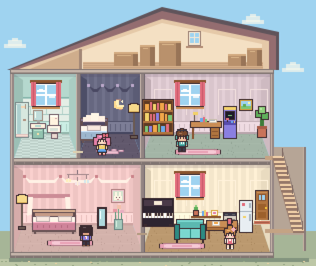
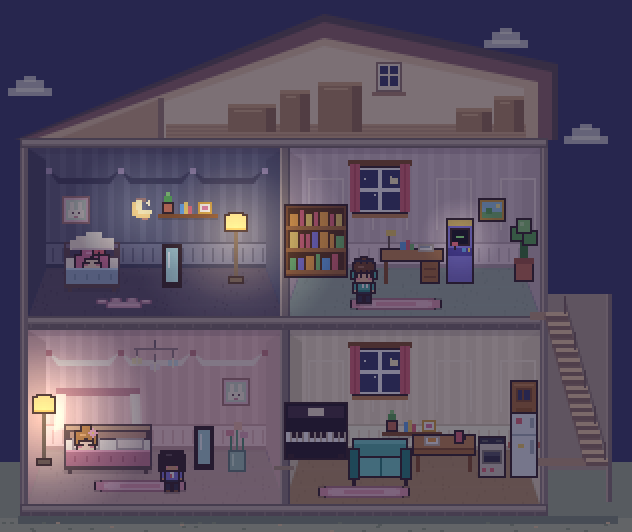

<div align="center">

# 🏠 像素小屋 · DollHouse

**一个可以放在口袋里的像素小人之家**

小人们会在房子里自己生活：上班上学、吃饭睡觉、弹琴打游戏、交朋友、谈恋爱……偶尔还会闹出点狗血剧情。
你负责布置房间、给他们换衣服，偶尔把谁拎起来换个地方。


**在线玩**：打开 <https://aubreykuang.github.io/DollHouse/> 就行。

**测试模式（金手指）· Test mode · テストモード**：[打开测试小屋](https://aubreykuang.github.io/DollHouse/dev.html)。开局就是 24 格宽、可住 8 人的最大户型，家庭基金显示 ∞，所有可购买家具无限取用。住户仍会按性格和需求活动。测试模式拥有独立存档，可随时回到正式版继续原进度。


**离线玩**：下载 [`pixel-dollhouse.html`](pixel-dollhouse.html)，双击用浏览器打开。


<sub>打开就能玩，电脑和手机都可以</sub>



<sub>白天的小屋 · 二楼左侧是独立卫生间，门前是住户可以走进去的院子</sub>

<br>


</div>

---

## ✨ 零素材：一切都是代码现场画出来的

游戏里**没有一张图片、一个 3D 模型、一段音频**。

- 🎨 **画面**：墙纸、地板、65 种家具，还有每个小人的发型、衣服、配饰，都是打开网页后用 Canvas 一个像素一个像素画出来的
- 🔊 **声音**：放家具的"咚"、吃零食的"咔嚓"、弹琴的音符、猫叫声和背景音乐，全部用 WebAudio 振荡器和噪声现场合成
- 🌗 **光影**：天色随时间变化，入夜后房间变暗，台灯、电视、彩灯、圣诞树会发出暖光
- 🌧 **天气**：窗外的雨丝、雪花、春天的花瓣、秋天的落叶都是一颗颗像素算出来的；下雨时还有合成的雨声

整个游戏可以打包成一个 HTML 文件。双击就能玩，不用联网，也不用安装任何东西。

> 新版截图直接取自游戏的 Canvas 画面。家具图册使用商店里同一套像素图标。

---

## 🎮 玩法一览

<table>
<tr>
<td width="50%" valign="top">

### 🏠 生活
小屋和院子占据主画面。点击小人，或展开右上角「住户与生活日志」，可以查看人物状态。
桌面和横屏会按可用高度等比缩放，完整显示屋顶到院子。手机竖屏时，画面铺满可用宽度，住户面板移到画面下方。
小人会根据精力、饱腹、快乐、社交和如厕需求，以及各自的性格，决定下一步做什么。

- 点击小人：查看状态卡、摸摸头
- 按住拖动：把小人**拎起来**放到别处。拖到另一位身边或身上，看到「放下和 TA 互动」就可以松手。两人会站到一起，根据关系和性格聊天、打闹或做其他互动。
- 选中小人后点家具：让 TA 去用那件家具

</td>
<td width="50%" valign="top">

### 🪑 布置
- 院子家具包括双座秋千、长椅、雏菊花箱和三人野餐桌。住户会自行出门，也能选中住户后点家具，安排荡秋千、休息、浇花或野餐。
- 奶油拼图桌可以两个人一起拼。院子里同用一件家具的住户也会增加友好度，并留下生活日志。
- 默认小屋的二楼左侧有独立卫生间，配有淋浴间、洗手台和马桶。已有存档可在「布置」中选择「恢复默认」换用这套布置。
- 进入「布置」，按 **生活家具、装饰摆件、兴趣家具、院子家具** 查找 64 款可选家具，另有固定的大门。
- 一楼卧室的门可以开关。在生活模式下点击卧室和客厅之间的门。
- 新家具要用 **🏦 家庭基金** 买，删掉的家具收进仓库，可以再拿出来
- **🔨 扩建**房子会真的变宽，并解锁更多家具
- 大门可以挪位置，但不能拆（大家要出门的嘛）
- 点已有家具可以拿起来移动，两层的地面和墙面都可以布置
- 8 种墙纸、6 种地板随意搭配
- 放好的家具，小人马上就会去用

</td>
</tr>
<tr>
<td valign="top">

### 👗 衣橱
- 5 种肤色 · 6 种发型 · 10 种发色
- 6 种上衣 · 3 种下装 · 12 种衣服颜色
- 7 种配饰：鸭舌帽、蝴蝶结、眼镜、耳机、猫耳、小花、王冠……
- 一键 🎲 随机搭配，可以改名、改性格、职业、性别和感情观

</td>
<td valign="top">

### 💞 人际关系
- 住户列表会在情侣双方名字下方显示恋人姓名。人物卡可直接点名字查看对方，选中其中一位时，屋内两人的名字会带上粉色爱心。
- 每对小人之间都有 **🤝 友好度** 和 **💗 恋爱度**
- 关系会从 陌生 → 认识 → 朋友 → 好友 → 挚友 慢慢发展
- 合得来的会心动、表白，表白成功就成为 **💕 恋人**
- 恋人晚上会叫对方一起睡 **双人床**，睡着时还会冒 💕
- 看到恋人和别人抱在一起会 **😤 吃醋**，然后过去找 TA 算账
- **花心**的人有了对象还会偷偷撩别人，被撞见就要吵架、分手 💔
- 卧室有双人床又没人时，花心的人会把暧昧对象叫进卧室、**关上门**——门外的恋人看不见，但要是推门进来……
- 合不来的会吵架，严重时会闹翻，恋人也可能分手

</td>
</tr>
</table>

<table>
<tr>
<td width="50%" valign="top">

### 💼 职业与作息
每个人都有职业，到点会从大门出门，下班再回来：

| 职业 | 时间 | 休息月份 |
|---|---|---|
| 🎒 学生 | 08:00–16:00 | 7、8 月（学生不参与恋爱剧情） |
| 💼 上班族 | 09:00–18:00 | 2 月 |
| 🥐 面包师 | 05:30–13:00 | 1 月 |
| ☕ 咖啡师 | 10:00–19:00 | 3 月 |
| 🌙 夜班店员 | 22:00–06:00 | 6 月 |
| 🎨 自由画家 / 🏠 宅在家 | 不出门 | — |

每月回家的时间都会浮动一点，偶尔早退，偶尔加班到很晚。
到家时大家会说"欢迎回来"，恋人会跑过来抱一下。

**💰 收入与储蓄**：下班到家领月薪（上班族 ¥320、夜班 ¥280、面包师 ¥240、咖啡师 ¥210，加班多拿 50%），学生有 ¥40 零花钱，自由画家偶尔卖画；宅在家的没有收入。
吃零食 ¥12、买菜做饭 ¥25，每月换月时交房租水电 ¥50（学生不用交）。钱不够时，恋人或好朋友会帮忙付；没人帮就只能饿着。

</td>
<td width="50%" valign="top">

### 🎭 开局的故事
一打开游戏，屋里就已经有一段关系网：

- 🍙 **团子**（专一）和 💤 **阿懒**（花心）是一对恋人
- 阿懒对 ⚡ **小桃**（咖啡师）也有点意思……
- 📚 **眼镜君**（专一）在暗恋小桃

团子是面包师，工作月份一大早出门挣钱；阿懒宅在家里，存款只有 ¥180，很快就得靠团子养。
接下来是阿懒移情别恋、团子撞破，还是小桃和眼镜君修成正果？每一局都不一样。

</td>
</tr>
</table>

---

## 📸 新版小屋

<table>
<tr>
<td width="50%"><br><sub>夜晚 · 台灯和月亮壁灯亮起，住户回各自的卧室睡觉。</sub></td>
<td width="50%"><br><sub>布置 · 用马桶、洗手台和淋浴间搭出洗漱角。绿色网格表示毛线篮可以放在这里。</sub></td>
</tr>
</table>

## 🪑 家具图册


| 分类 | 新家具 | 住户会做什么 |
|---|---|---|
| 生活家具 | 奶油马桶、薄荷洗手台、贝壳淋浴间、云朵床 | 按需求如厕、洗手、淋浴和睡觉。放好马桶后，如厕需求会随时间变化。 |
| 装饰摆件 | 月亮壁灯、兔兔挂画、星云吊饰、郁金香花瓶、猫爪地毯 | 壁灯夜里发光，吊饰会轻轻摇动，猫爪地毯可以走过。 |
| 兴趣家具 | 蜜桃唱片机、奶油棋桌、草莓毛线篮、蜜糖尤克里里 | 听唱片、下棋、编织、弹琴。两名住户一起下棋会增加友好度，并记入月报。 |

新增家具还有莓果梳妆台、奶油洗衣篮、雏菊茶几、薄荷瑜伽垫、蜜桃沙袋、奶糖手工台、柠檬工具箱、星星相册桌、薄荷香草架、便签软木板、长耳兔玩偶和绣球纸灯。

新存档的仓库里有马桶、洗手台、猫爪地毯和毛线篮，可以直接拿出来试。布置时点家具卡选择物品，再点击房间里的格子。卡片会显示家具的用途、价格或库存。

<details>
<summary>早期版本截图</summary>

[围观演奏](docs/party.png) · [家具商店](docs/shop.png) · [衣橱](docs/wardrobe.png) · [手机版](docs/mobile.png) · [旧版日报](docs/daily-paper.jpg)

</details>

---

## 🧸 九种性格与日常活动

| 性格 | 特点 | 喜欢 |
|:---:|---|---|
| ⚡ **元气** | 走路最快，坐不住，看书坐沙发都只待一会儿；不爱睡觉 | 打游戏、跳舞 |
| 💤 **懒懒** | 走路最慢，一坐就是很久，还会站着打盹；讨厌跳舞 | 睡觉、窝沙发、看电视、泡澡 |
| 📚 **书虫** | 一看书就停不下来，很少主动找人聊天 | 看书、弹琴、浇花 |
| 🍙 **吃货** | 饿得特别快，吃起来没完 | 翻冰箱、做饭、蹭别人的饭 |
| 💬 **社牛** | 会留意有空的室友和对方的心情 | 夸穿搭、问近况、写卡片 |
| 🧵 **巧手** | 爱在工作台旁做东西 | 缝布贴、织毛线、修小物 |
| 🎀 **爱打扮** | 常去梳妆台，也会注意室友的配饰 | 试配饰、对镜练舞、做手账 |
| 👟 **运动派** | 精力充足时主动运动 | 练拳、瑜伽、拉伸 |
| 🧺 **爱整洁** | 喜欢把日常小物收好 | 叠毛巾、照料香草、整理笔记 |

住户也会按场景触发 15 个短活动。元气住户会早上拉伸，有熟人空闲时才可能玩拍手游戏；懒懒会靠在沙发上打盹，雨雪时可能去窗边；书虫会研究残局，晴夜才会记星图；吃货会抄写食谱、闻香草或交换做法。短活动有个人冷却，也会避开过饿、太累等情况。月报会记录住户日常。

每种性格还有自己的口头禅：元气会喊"比赛谁先跑到门口！"，懒懒聊着聊着就"zzz"，书虫张口就是"你知道吗，章鱼有三颗心脏"。

## ♈ 星座与 MBTI

衣橱可直接选择 **16 种 MBTI**，会显示各自的活动偏好。基础性格、MBTI、星座和当下需求共同影响选择。同样是书虫，INTJ 更爱研究残局和整理笔记，INTP 更可能修理小物或在晴夜记星图。

| | 影响 |
|---|---|
| **E / I** | 外向的人社交需求掉得快、更爱聊天和凑热闹；内向的人更爱看书、看鱼、上网，聊完天会有点累 |
| **S / N** | 实感型偏爱做饭、跑步、浇花；直觉型偏爱看书、画画、弹琴、上网 |
| **T / F** | 情感型更容易心动、被背叛时更受伤；两个思考型吵完架不太记仇 |
| **J / P** | 判断型做事专注、上班准时；感知型爱闲逛、更随性，上班常常踩点 |
| 🔥🌍💨💧 **星座元素** | 火象爱玩（跳舞、游戏、运动），土象务实（做饭、学习），风象爱交流（聊天、上网、音乐），水象敏感（泡澡、钢琴、画画），吃醋更厉害 |
| 💞 **缘分** | 同元素、互补元素（火配风、土配水）缘分高，对冲元素（火配水、风配土）缘分低；MBTI 的"黄金搭档"（如 INTJ × ENFP）再加成。缘分越高，关系涨得越快、表白越容易成功。人际关系里用 ★ 显示 |
| 🎂 **生日** | 生日显示到月份。进入生日月时庆祝一次，关系好的人可能送礼物 |

开局的四个人：小桃 ♈ ENFP、阿懒 ♊ ISTP、眼镜君 ♒ INTJ、团子 ♉ ISFJ。
阿懒和团子（风象 × 土象）缘分只有 ★★，阿懒和小桃（风象 × 火象）却是 ★★★★；眼镜君和小桃是 INTJ × ENFP 的黄金搭档。

实测：两个都是"元气"、需求完全相同的人，ENFP 白羊座 4 天里主动聊天 74 次，ISTJ 金牛座只有 11 次，更多是自己跳舞。

## 💘 感情观

| | 有对象之后 |
|:---:|---|
| 💍 **专一** | 感情会越来越深；别人示好会直接拒绝："我已经有对象了！" |
| 🙂 **普通** | 顺其自然，偶尔动摇 |
| 🎒 **学生** | 不管感情观是什么，职业是学生的人只交朋友：不会表白、亲亲、暧昧、偷情，也不会成为谁的恋人 |
| 🦋 **花心** | 对恋人的感情会慢慢变淡；会偷偷撩别人，恋人去上班时更大胆。被恋人撞见就吵架甚至分手；新欢比旧爱更喜欢时，会直接甩掉旧爱 |

## 💬 小人之间会发生的事

| 互动 | 什么时候发生 | 效果 |
|---|---|---|
| 聊天 / 打闹 | 随时 | 友好度上升；熟了以后会慢慢心动 |
| 🤗 抱抱 | 友好度够高 | 友好度和恋爱度都上升 |
| 💌 表白 | 心动了，而且双方都单身 | 成功会更喜欢对方，恋爱度够高就在一起；失败会有点难过 |
| 💋 亲亲 | 恋人之间 | 恋爱度上升 |
| 🛏 一起睡 | 恋人中的一个躺上双人床，另一个也困了或者已经是晚上 | 会叫对方来睡另一边，睡着时恋爱度慢慢上升；双人床只和恋人分享 |
| 💢 吵架 | 合不来，或者心情很差 | 友好度和恋爱度下降，严重时闹翻或分手 |
| 😤 吃醋 | 恋人看到另一半和别人抱在一起 | 恋爱度下降，等两人都有空就过去"算账"吵一架 |
| 🤫 地下情 | 花心的人背着恋人和别人亲近 | 变成"偷偷暧昧"；恋人在附近就会被撞见：大吵一架、感情暴跌，可能当场分手 |
| 🎵 围观 | 有人在弹琴、跳舞、打游戏、看电视、做饭、看书 | 凑过去听、一起跳、加油、蹭饭……大家都会更开心 |

关系每次跨过门槛（成为好友、在一起、闹翻、分手），屏幕下方都会弹出提示。

## 🚪 卧室

房子左边隔出一间卧室（双人床、单人床、浴缸），和客厅之间有一扇门：

- 门开着时两边能互相看见；**门关上，外面就看不到里面**
- 花心的人趁卧室里有双人床、又没有别人时，会把暧昧对象叫进去，自动关门亲热，恋人在客厅浑然不知
- 恋人推门走进卧室（比如下班回来想睡一觉）就会当场撞破 💥
- 在生活模式下点门可以手动开关

## 🌦 季节、天气与节日

| | |
|---|---|
| 🌸 季节 | 一年 12 个月。3–5 月为春季，6–8 月为夏季，9–11 月为秋季，12–2 月为冬季。 |
| 🌧 天气 | 每半天变一次：春夏秋会下雨，冬天会下雪。窗外下雨下雪，雨天屋里会暗一点；出门遇上下雨会说"带上伞"，回来可能淋成落汤鸡；下雪时元气和社牛会兴奋地喊"下雪啦！" |
| 🔥 开销 | 冬天每晚多交 ¥20 暖气费，夏天多交 ¥10 空调费 |
| 🧧 春节 | 2 月：大家拜年，有工作的人给学生发 ¥88 红包；挂上灯笼更热闹 |
| 🥮 中秋 | 9 月：一起吃月饼、赏月 |
| 🎄 圣诞 | 12 月：恋人和好朋友互送礼物；家里有圣诞树的话，大家会围着它过节、跳舞 |

## 🏦 家庭基金与扩建

| | |
|---|---|
| 💰 存钱 | 上班的人领工资时自动存 20% 进家庭基金；也可以点 **📣 号召大家凑钱**（每月一次），每人按性格拿出闲钱的一部分：社牛最大方，懒懒最抠，没钱的会说"下次一定" |
| 🛒 买家具 | 每件家具都有价格（盆栽 ¥120 到钢琴 ¥2,500），放进房间时从基金里扣；删掉的家具进仓库，再放出来不用钱 |
| 🔨 扩建 | 小屋（16 格宽，最多 5 人）→ ¥3,000 温馨小家（20 格，6 人，解锁书桌、电脑桌、音响、彩灯）→ ¥8,000 梦想之家（24 格，8 人，解锁画架、跑步机） |
| 💼 找工作 | 宅在家的人欠债超过 ¥500，就有可能出门找份工作 |
| 💭 许愿 | 小人会念叨"要是家里有电脑桌就好了"，告诉你大家想要什么 |

新家具带来的玩法：喝咖啡提神（¥6 一杯）、看鱼、写作业、上网、跑步（原地跑，会累会饿）、画画（自由画家画过画，当晚卖画的几率翻倍）。有人放音乐，大家会跟着跳舞；有人上网、画画，也会有人凑过来看。

## 📜 生活日志与月报

侧边栏的日志会按年月归档发生过的事：出门回家、工资和房租、拥抱亲亲、表白、吃醋、撞破、分手、帮忙付钱……
日志保留最近 300 条，随存档保存，也可以在侧边栏清空。

每月结束生成一期 **小屋月报**，最多三条故事。表白、分手、新住户和意外插曲优先，平静的月份一句话就够。故事旁会显示相关住户当期的像素形象，头条小人登场时会轻轻跳一下。

默认在下月 00:00 弹出。「上一期 / 下一期」可以回看最近 30 期。可以复制正在看的那期、导出像素风 PNG 纪念卡，或在「设置」关闭自动打开。

## 💞 信任、醋意与搭子

- **信任是单向的**：被当众开玩笑的人会少一点信任，吵架双方都会互扣信任，帮忙分饭、陪着弹琴或打游戏会加信任。人物卡的关系行会显示“信任 / 不太信任 / 很提防”，以及 20 点以上的“😤 醋意”。
- **醋意会留下来并慢慢消退**：看到恋人和别人亲密、撞见偷情、被甩，醋意都会记在对方身上，大约一天降 40 点。
- **抢走恋人的人会被记住**：撞见偷情和被花心的人甩掉时，受伤的一方会单独留下一条记忆，主语是第三者，例如“小桃抢走了阿懒”。
- **误会会传错事实**：转述目击事件时，有一定概率听岔，把事情记到另一个人头上（比如听成“眼镜君偷偷和别人约会”），同时降低听者对被冤枉者的信任。
- **饭搭子 / 游戏搭子**：在大餐桌同桌吃饭满 3 次、一起打游戏满 3 次，两人会成为搭子。之后看到搭子在吃饭或打游戏，会更想凑过去。
- **爱美**：一部分住户（浪漫型、社交型更常见）带「✨ 爱美」特质，会更常去照镜子，照完心情更好。
- **卧室隐私**：待在卧室里的人，只会被同屋的人或恋人叫去聊天，其他人不会进来打扰。内向的人也更喜欢用卧室里的家具。

## 🕰 离线、快照与时光回溯

- 关掉页面以后，小屋会继续过日子，重新打开时最多补算一整天，并在日志里写下“你不在的 N 小时里发生了几件事”。可以在月报弹窗里关闭这个功能。
- 每月开始会自动留一份快照，最多保留 4 个月。月报弹窗底部的「时光回溯」可以回到其中任何一个月初。
- 存档升级到 v2：旧版存档会自动补上信任、醋意和搭子数据，不会被丢弃；比当前版本新的存档会拒绝读取。

---

```bash
git clone git@github.com:AubreyKuang/DollHouse.git
open DollHouse/pixel-dollhouse.html
```

**小提示**
- 声音默认关闭，点右上角 🔇 打开。白天是轻快的芯片音乐，晚上会变成慢慢的摇篮曲
- 新游戏从 **1 年 1 月 00:00** 开始。一个完整昼夜推进一个月，正常速度约 6 分钟。用 ⏸、▶、⏩ 暂停、继续或快进。
- 进度自动保存在浏览器里，关掉再打开还是原来的房间

---

## 🎉 朋友来访、派对与入住

- 傍晚，醒着且在家的住户有机会主动邀朋友来玩。右侧的「串门与派对」也可以选一位住户做东，办茶点、音乐或游戏派对。
- 朋友会从门口走进客厅。有空的室友可以加入，在音乐派对跳舞、在茶点派对吃点心、在游戏派对聊棋局和玩桌游。访客结束后从门口离开，来访与派对会写入生活日志和月报。
- 玩得开心、和邀请人的关系够好时，朋友有机会留下入住申请。点「邀请新住户」可以先看申请，或另邀一位新朋友。访客不占住户名额，房子住满时申请仍会保留。接受后，新住户会保留名字、外貌、性格和之前认识的室友。
- 正式版和测试模式分别保存来访、申请和入住进度。


## 🛠 开发

源码拆成了几个文件，方便修改：

```
├── index.html          正式版页面结构
├── dev.html            测试模式入口（由 build.py 生成）
├── style.css           界面样式，支持浅色 / 深色模式
├── js/
│   ├── calendar.js     年月换算与显示
│   ├── data.js         家具、性格、服装、墙纸地板等数据
│   ├── sprites.js      墙纸、地板、家具的像素绘制
│   ├── doll.js         小人的像素绘制：发型、衣服、配饰、朝向、动画
│   ├── audio.js        WebAudio 合成音效和背景音乐
│   ├── npc-memory.js   记忆写入、检索和长期归纳
│   ├── save-manager.js 浏览器快照保存与回退
│   ├── game.js         游戏状态、BFS 寻路、需求系统、性格 AI、昼夜时间
│   ├── social.js       人际关系、多人互动、围观、地下情与修罗场
│   ├── work.js         职业、作息、出门回家、大门、收入与储蓄
│   ├── furniture2.js   咖啡机、鱼缸、书桌等家具和活动
│   ├── furniture3.js   生活、装饰和兴趣家具的像素图与活动
│   ├── furniture4.js   梳妆、手工、运动等家具和活动
│   ├── routines.js     性格、家具、天气和关系触发的日常活动
│   ├── community.js    来访、派对与入住申请
│   ├── economy.js      家庭基金、商店、仓库、扩建、许愿
│   ├── rooms.js        房间隔墙和门、视线、旧布置调整
│   ├── house-view.js   四间房剖面、阁楼、楼梯与画面坐标
│   ├── house-life.js   月报和住户生活事件
│   ├── season.js       季节、天气、窗外雨雪、节日、圣诞树和灯笼
│   ├── astro.js        星座、MBTI、缘分、生日
│   ├── view.js         渲染排序、光照、拖拽和摆放交互
│   └── ui.js           住户列表、状态卡、布置面板、衣橱、主循环
├── build.py            把以上文件合并成单个 HTML
└── pixel-dollhouse.html  打包好的成品
```

改完源码后重新打包：

```bash
python3 build.py
```

---

<div align="center">
<sub>用 Canvas 和 WebAudio 一个像素、一个音符地拼出来的小房子 🏡</sub>
</div>

## NPC 记忆系统与测试

争吵、拥抱、亲吻、表白、分食晚饭和撞见暧昧会形成记忆。旁观者能记住满足距离和视线条件的事件。朋友可能转述目击事件，听者会记录来源和可信度，有时也会误会。双方各自保存对同一件事的理解，记忆会调整后续选择社交对象的权重。

记忆由确定性 JavaScript 规则生成，无需 LLM 或 API 密钥。客观事件与角色主观记忆分开存储，记忆引用来源事件 ID，并记录情绪、确信程度和获知方式。连续事件序号用于拒绝重复处理和检测序号缺口。

每位 NPC 最多保留 32 条短期记忆、50 条长期记忆。重要程度由统一权重计算，同类重复经历可合并为长期印象。当前人生摘要选取最多 8 条长期记忆。记忆随现有 LocalStorage 存档保存，旧存档在产生新记忆时初始化相关数据。

### 运行回归测试

在项目根目录使用支持内置测试运行器的 Node.js（本次验证使用 Node.js 22）运行：

```sh
node --test tests/*.test.cjs
```

回归测试覆盖入口脚本语法、主观视角与信息隔离、事件去重与序号缺口、结构化记忆合并、短期容量和来源保留、确信程度、20 次 JSON 保存读回，以及实际互动入口、家具分类、如厕和存档、双人棋桌、跨年换月和生日去重。测试调用实际代码，并模拟所需的渲染、计时器或其他外部依赖。

### 当前边界

- 这是基础记忆版本。Working Memory 继续使用既有角色运行状态，尚未实现完整的当前行动恢复。
- 长期记忆超过 50 条时按重要程度和时间截断，人生摘要也有上限，尚不能保证所有重要人生经历永久保留。
- 事件记录支持记忆来源追踪和去重，尚未实现世界状态的事件重放。
- 已实现 LocalStorage 主档、上一有效快照回退、v1→v2 版本迁移和最近 4 个月的月初快照。IndexedDB 和导入导出尚未实现。
- JSON 往返测试验证结构化数据保留，浏览器关闭重开、地图与物品恢复、完整游玩流程仍待端到端验收。

## 🏠 房间与旧存档

一楼是粉色卧室和客餐厅，二楼是深色卧室和书房。右侧楼梯间连接上下层，关门和楼层会影响目击及围观。可以把小人拎到另一层，也可以在两层摆家具和挂墙饰。

旧存档会保留住户、家具、关系、记忆和进度。挡住隔墙、门口或楼梯落点的家具会移到同层最近的空位。同层已满时收入仓库，并写入日志。旧存档的时间序号按月份换算，旧日报也会显示新年月。
