<div align="center">

# 🏠 像素小屋 · DollHouse

**一个可以放在口袋里的像素小人之家**

小人们会在房子里自己生活：上班上学、吃饭睡觉、弹琴打游戏、交朋友、谈恋爱……偶尔还会闹出点狗血剧情。
你负责布置房间、给他们换衣服，偶尔把谁拎起来换个地方。

**在线玩**：<https://aubreykuang.github.io/DollHouse/>

**测试模式（金手指）**：[打开测试小屋](https://aubreykuang.github.io/DollHouse/dev.html) —— 开局就是 24 格宽、可住 8 人的最大户型，家庭基金 ∞，所有家具无限取用，独立存档。

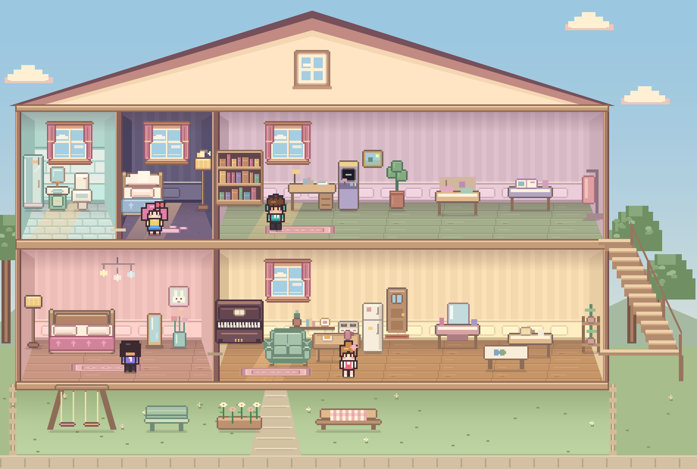

**离线玩**：下载 [`pixel-dollhouse.html`](pixel-dollhouse.html)，双击用浏览器打开。

<sub>打开就能玩，电脑和手机都可以 · 目前只有中文界面</sub>

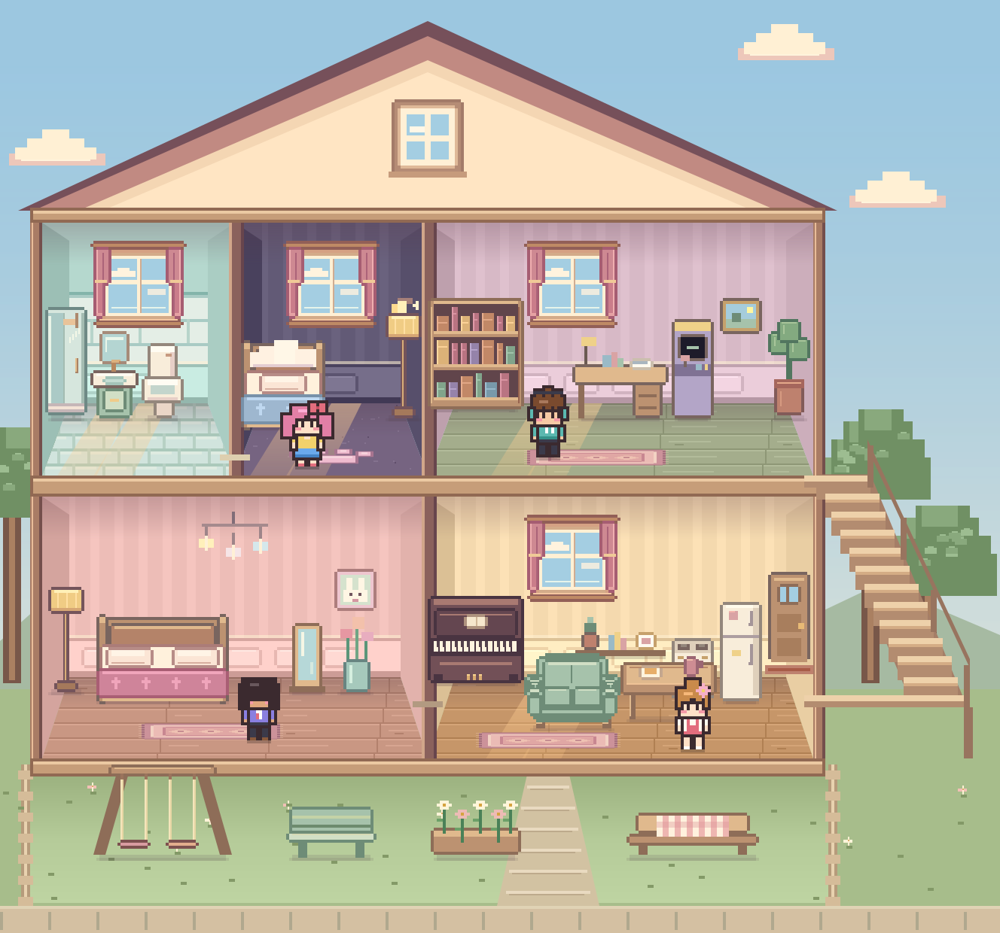

<sub>白天的小屋 · 二楼左侧是独立卫生间，门前是住户可以走进去的院子</sub>


</div>

---

## ✨ 像素小屋的画面与声音

- 🎨 **画面**：住户、室内外家具与地板都用 Canvas 像素绘制。家具共用暖木色、奶油色、薄荷绿和低饱和粉色，描边与落地阴影保持一致；商店图标、布置预览和落地后的家具使用同一套画法。
- 🏡 **房屋**：对称三角屋顶、居中阁楼窗、开放式木楼梯，清理了阁楼杂物和墙面的多余装饰线。二楼卫生间、卧室和书房都有窗户；旧存档只在空闲墙面补窗，之后移动或拆下的窗户不会在读档时重新出现。
- 🔊 **声音**：放家具的“咚”、吃零食的“咔嚓”、弹琴的音符、猫叫和背景音乐，全部用 WebAudio 振荡器和噪声现场合成（默认静音，点右上角 🔇 打开）
- 🌗 **光影**：天色随时间变化，入夜后房间变暗，台灯、电视、彩灯、圣诞树会发出暖光
- 🌧 **天气**：窗外的雨丝、雪花、春天的花瓣、秋天的落叶都是一颗颗像素算出来的；下雨时还有合成的雨声

整个游戏可以打包成一个 HTML 文件，双击就能玩，不用联网，也不用安装任何东西。

---

## 🎮 怎么玩

打开游戏时会展开「住户与生活日志」。桌面上它在房子旁边，手机竖屏时在房子下方。点标题可收起。

### 🎂 值得一起记住的小事

「小屋时光」现在可以**一起过生日、教我一道菜、陪我练一小段、一起学手作**。生日有主角，教学有想学的人和更熟练的室友；大家会实际走到家具旁，轮流说话，完成后才留下关系变化与相册。

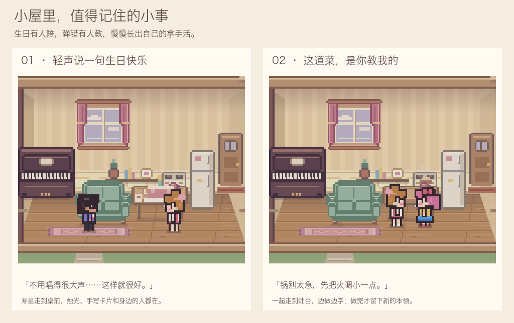

- **生日月的小仪式**：餐桌上出现小蛋糕、蜡烛和卡片。内向的寿星会收到轻声的祝福；外向的寿星喜欢大家一起许愿。开场花家庭基金 ¥20，同一住户每年只庆祝一次。月初提醒不再隔空送礼、扣个人存款或直接增加好感。
- **室友也会记得**：傍晚，亲近且有空的室友可以主动准备生日，不增加额外访客。每位寿星每月最多自动邀约一次；取消后不反复催，仍可手动重约。没有参加不会扣关系或留下负面惩罚。
- **慢慢长出拿手活**：完成做饭、弹琴/尤克里里、手作/编织/修小物，会分别积累做饭、音乐、手作本领。从刚开始尝试，到学会小旋律、家常炖菜或漂亮针脚；人物卡显示学会的具体内容，重要进步留下当时的立绘和回忆。每月成长有上限，不需要反复刷家具。
- **“这一步，教教我吧”**：选择想学的人，再选一位更熟练的室友。学做饭使用家庭基金 ¥15，音乐和手作免费。住户练习后也可能主动请教朋友，整个小屋每月最多自动发生一次；有心结或不愿相处的人不会被强行拉到一起。
- **本领有用处**：会做饭的人更能吃得满足；音乐更熟练时，真正站在旁边听的室友也更开心；手作越熟练越适合带别人练习。初始本领会参考职业与性格，已有成长随存档保留，换职业不会抹掉本领。

开场只在实际集合后收费，读档不会重复扣钱。中途离开不算学会；寿星或老师没到场，不会由旁人代替完成。移动家具后会重新找位置，优先避开遮住小人的桌子和沙发。测试模式免除材料费用，也仍需真正参加活动。

### 🕯 晚归时，桌上有你的饭

有人还在加班，体贴的室友做完饭后，会真的端一份到餐桌上，盖好饭、亮起小灯，留下写给那个人的便签。爱吃的住户会说“多盛了一份”，爱整洁的人会把碗筷放好，内向的人只留一句轻轻的叮嘱。点餐桌可以读便签。

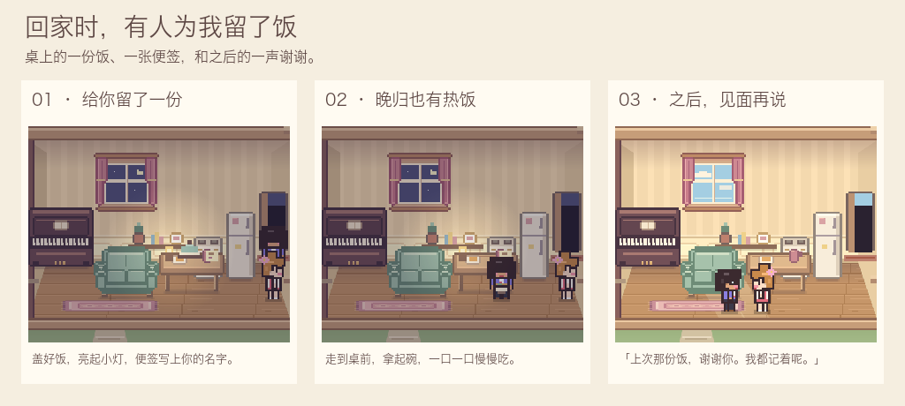

- 晚归的人实际走到桌前吃饭，端碗和舀饭有小动作；这份饭不再扣钱。只有吃掉的部分才恢复饱腹和精力，吃完才留下关系变化、个人记忆和带双方立绘的相册卡。
- 下一个昼夜开始后，双方都在家、有空且愿意相处时，吃饭的人可能主动走过去道谢。对白根据性格变化，只有真正见面说完才记入日志；有未解心结的人不会因为一份饭自动和好。
- 每位做饭的住户每个游戏月最多留一次，同时最多保留两份；没有晚归住户或可达餐桌时不会凭空生成饭。夜班跨月回家也能收到一份早餐。
- 做饭中断不会生成留饭。端饭被打断、吃到一半存档、挪动餐桌，都保留已有进度并重新找路；拆掉桌子或住户搬走会清理相关留饭。放得太久会安静收起，没有玩家任务或失败惩罚。

### 📖 小屋时光：把日子过成我们的故事

顶栏新增「小屋时光」。住户会按性格惦记一些小事：吃货想一起吃热饭，书虫想把故事讲下去，元气住户想开家里的音乐会。最多同时保留两个未实现的心愿，没有期限、失败扣分或每日签到；忙的时候可以先放着。

| 活动 | 家具 | 发生什么 |
|---|---|---|
| 🍲 一起吃顿饭 | 餐桌 | 两到四位住户走到桌前，轮流聊一天里的小事。开饭时使用家庭基金 ¥30，没钱的住户也能吃；测试模式免费。 |
| 📖 围坐讲故事 | 沙发或书架 | 每人接一句，书虫认真讲、吃货惦记点心、懒懒想听睡前故事。免费。 |
| 🎵 小小音乐会 | 钢琴、唱片机或尤克里里 | 有人唱、有人成为观众，活泼的住户会跟着打拍子。免费。 |

选择两到四人后，大家会自己走过去；要留出可达空位。上班、睡觉或忙着其他活动的人不会被强行拉来，有感情心结的两人也可以分别邀请。只有实际集合、共同待完才增加友好度、满足参与者的心愿并留下记忆。中途可以点画面下的「先散啦」，没有完成也不会惩罚。读档会重新集合，已经付过的饭钱不会再次扣除。

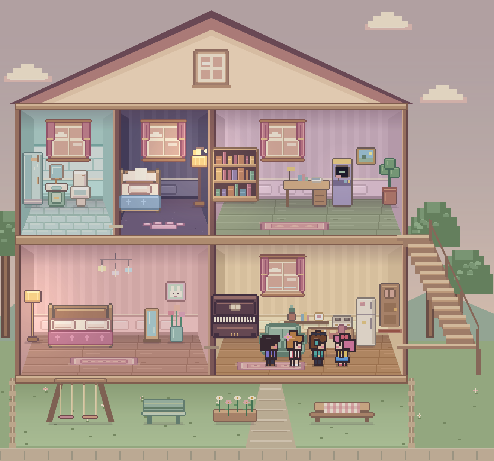

**我们的相册**保留那个月的人物模样、名字和天气：一起吃饭、讲故事、音乐会，以及恋爱确认、手作花架和雨天老地方，都可能成为一张回忆卡。之后换装不会改变旧照片。可珍藏、筛选珍藏、下载带像素立绘的 PNG 纪念卡；相册最多 120 个时刻，其中最多珍藏 60 个，清理时优先保留珍藏。

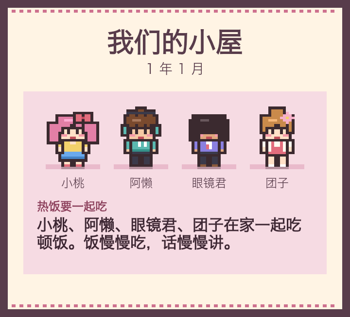

阅读小屋时光或备份预览时，游戏时间会暂停，关上继续。手机窄屏时心愿和相册改为单列；减少动态效果设置也会生效。

**🏠 生活模式**（默认）

- **点小人**：查看状态卡（性格、职业、星座 / MBTI、精力 / 饱腹 / 快乐 / 社交 / 如厕、存款、人际关系），也可以摸摸头
- **先点小人，再点家具**：安排 TA 去用那件家具（吃饭、弹琴、看书、睡觉……）
- **按住拖动**：把小人拎起来。拖到另一位身边松手，两人会聊天、打闹或互动；拖到一件能用的家具上，TA 会直接去用它；拖到空地就放下。拎着的时候其他人会先定住，方便你瞄准
- **点门**：开关一楼卧室和客厅之间的门。门关上，外面就看不到里面

小人会根据需求和性格自己决定下一步做什么。桌面和横屏会按可用高度等比缩放，完整显示屋顶到院子；手机竖屏时画面铺满宽度，住户面板移到画面下方。

**🪑 布置模式**：选家具卡片，再点房间里的格子放置。第一次点是确认意向，第二次点同一格才真的扣钱；仓库里有的家具再放出来不用钱。点已有家具可以拿起来移动，右键 / Esc 取消。删掉的家具收进仓库，大门可以挪位置但不能拆。

- 64 款可购买家具，另有大门和住户制作的手作花架：生活家具、装饰摆件、兴趣家具、院子家具（秋千、长椅、花箱、野餐桌）
- 8 种墙纸、6 种地板随意搭配；两层的地面和墙面都可以布置
- 🔨 **扩建**：小屋（16 格宽，最多 5 人）→ ¥3,000 温馨小家（20 格，6 人）→ ¥8,000 梦想之家（24 格，8 人），房子会真的变宽并解锁新家具

**👗 衣橱**：5 种肤色 · **15 种发型** · 14 种发色 · **15 种上衣** · 6 种下装 · 18 种衣服颜色 · 4 种鞋款 · 13 种头饰/眼镜，另有围巾、斜挎包和双肩包。沿用最初 12×20 像素小人的比例和画法，四位开局住户保留原来的穿搭和发型。

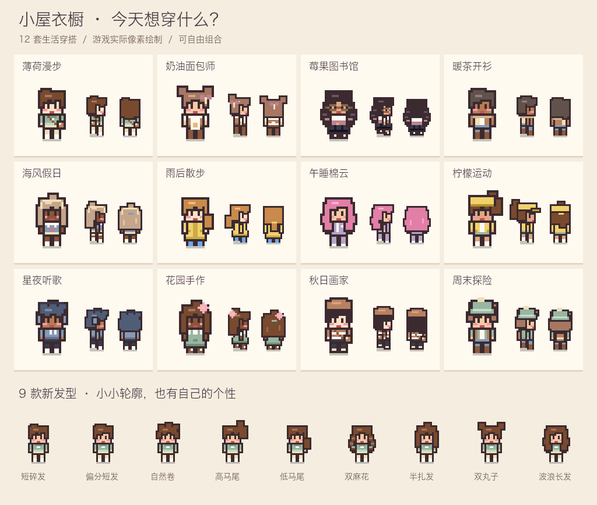

- **今日穿什么**：薄荷漫步、奶油面包师、莓果图书馆、雨后散步等 12 套生活穿搭。每张卡都用当前住户的肤色、头发试穿；点击只换衣服，不改人物身份和发型。
- **发型和细节**：新增短碎发、偏分、自然卷、高/低马尾、双麻花、半扎发、双丸子和波浪长发。围裙有口袋，雨衣有后领，背包正面是肩带、背面才是包；围巾能和眼镜同时佩戴。
- **小脸和生活动作**：衣橱可选原版小脸、小雀斑、桃桃脸颊、小泪痣；原有住户不自动改妆。侧面下巴修成干净的像素折角，耳朵、眼镜镜片和衣领更容易分辨。说话时轻轻动手，晚归疲惫时眼神放松，吃饭会端碗、舀一口；碗从背面看会被身体挡住。
- **看清再换**：支持正面、左右侧、背面，以及站立、走路、坐下、跳舞预览。头像按整数倍放大，保持像素清晰；手机使用紧凑预览和两列搭配卡。
- **轻松试穿**：「换套搭配」保留头发和肤色；「随机形象」也会换头发和肤色。随机来客使用协调的整套配色，所有款式仍可手动组合。「还原本次穿搭」分别记住每位住户打开衣橱时的样子；关闭后保存，下次打开以新穿搭为起点。
- 名字仍可直接编辑；性格、职业、性别、星座、MBTI 和感情观放在「人物设定」。换装不改变相册里已经留下的旧模样。

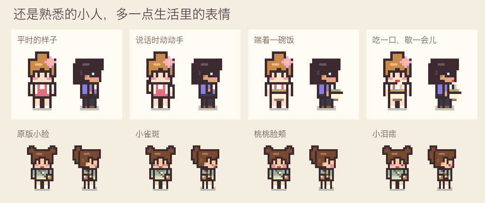

---

## 🧸 住户

开局四位，关系网已经纠缠好了：🍙 团子（专一）和 💤 阿懒（花心）是一对恋人，阿懒对 ⚡ 小桃（咖啡师）也有点意思，📚 眼镜君（专一）在暗恋小桃。团子是面包师，工作月份一大早出门挣钱；阿懒宅在家里，存款只有 ¥180，很快就得靠团子养。接下来是阿懒移情别恋、团子撞破，还是小桃和眼镜君修成正果？每一局都不一样。

| 性格 | 特点 | 喜欢 |
|:---:|---|---|
| ⚡ 元气 | 走路最快，坐不住，不爱睡觉 | 打游戏、跳舞 |
| 💤 懒懒 | 走路最慢，一坐就是很久，还会站着打盹 | 睡觉、窝沙发、看电视、泡澡 |
| 📚 书虫 | 一看书就停不下来，很少主动聊天 | 看书、弹琴、浇花 |
| 🍙 吃货 | 饿得特别快，吃起来没完 | 翻冰箱、做饭、蹭别人的饭 |
| 💬 社牛 | 会留意有空的室友和对方的心情 | 夸穿搭、问近况、写卡片 |
| 🧵 巧手 | 爱在工作台旁做东西 | 缝布贴、织毛线、修小物 |
| 🎀 爱打扮 | 常去梳妆台，也会注意室友的配饰 | 试配饰、对镜练舞、做手账 |
| 👟 运动派 | 精力充足时主动运动 | 练拳、瑜伽、拉伸 |
| 🧺 爱整洁 | 喜欢把日常小物收好 | 叠毛巾、照料香草、整理笔记 |

每种性格还有自己的口头禅和 15 个场景短活动（早上拉伸、雨天窗边发呆、晴夜记星图……）。衣橱可直接选 **16 种 MBTI**，基础性格、MBTI、星座和当下需求共同影响选择；同元素、互补元素的缘分高，MBTI“黄金搭档”再加成，人际关系里用 ★ 显示。

### 💼 职业与钱

| 职业 | 时间 | 休息月份 | 月薪 |
|---|:---:|:---:|---:|
| 🎒 学生 | 08:00–16:00 | 7、8 月 | ¥40 零花钱 |
| 💼 上班族 | 09:00–18:00 | 2 月 | ¥320 |
| 🥐 面包师 | 05:30–13:00 | 1 月 | ¥240 |
| ☕ 咖啡师 | 10:00–19:00 | 3 月 | ¥210 |
| 🌙 夜班店员 | 22:00–06:00 | 6 月 | ¥280 |
| 📚 图书管理员 | 09:00–17:00 | 10 月 | ¥230 |
| 💐 花艺师 | 07:00–15:00 | 11 月 | ¥240 |
| 🩺 护理师 | 07:00–19:00 | 4 月 | ¥360 |
| 👩‍🍳 餐厅厨师 | 11:00–21:00 | 5 月 | ¥330 |
| 🎼 音乐老师 | 13:00–20:00 | 8 月 | ¥300 |
| 🪚 木工 | 08:00–17:00 | 10 月 | ¥310 |
| 💻 程序员 | 10:00–19:00 | 9 月 | ¥380 |
| 📦 快递员 | 08:00–18:00 | 1 月 | ¥280 |
| 🎨 自由画家 / 🏠 宅在家 | 不出门 | — | 卖画 / 无收入 |

共 **15 种职业/生活身份**。在「衣橱 → 人物设定 → 职业」选择；新邀请的住户也可能从事这些工作。下班话题会说到找回童年读物的读者、第一次跟上节拍的学生、终于排除的报错，或送到最后一个包裹的心情，室友会接着回应。

职业也影响在家的偏好：图书管理员更爱读书和整理笔记，花艺师照料花草，木工常做手作、修小物。新来的厨师、音乐老师和木工有相应基础本领，护理师更愿意照顾需要帮助的室友。仍由个人性格、需求和关系共同决定行为。

转职从下一个游戏月使用新作息；如果正在上班，会先完成原来的班、领取原来的工资，回家后再切换。待转职业会在人物卡显示，并随存档保留。

到点会从大门出门，下班再回来；每月回家的时间会浮动一点，偶尔早退、偶尔加班（加班多拿 50%）。工资的 20% 自动存进**家庭基金**（买家具、扩建都用它），也可以每月一次 📣 号召大家凑钱。

**开销**：每晚 0 点每人交房租水电 ¥50（学生不用交），冬天另加 ¥20 暖气费，夏天 ¥10 空调费；吃零食 ¥12、买菜做饭 ¥25。钱不够时，恋人或好朋友会帮忙付；没人帮就只能饿着。宅在家的人欠债超过 ¥500，就有可能出门找份工作。

### 💞 关系

每对小人之间都有 🤝 友好度和 💗 恋爱度，从陌生 → 认识 → 朋友 → 好友 → 挚友慢慢发展。合得来的会心动、表白，成功就成为 💕 恋人；恋人晚上会叫对方一起睡双人床，睡着时还会冒 💕。看到恋人和别人抱在一起会 😤 吃醋；花心的人有了对象还会偷偷撩别人，被撞见就要吵架、分手 💔。

信任是单向的，醋意会留下来并慢慢消退；一起吃饭、打游戏满 3 次会成为饭搭子 / 游戏搭子，之后更想凑过去。记忆由确定性规则生成：争吵、拥抱、表白、分食晚饭和撞见暧昧都会形成记忆，朋友转述时还有可能听岔、冤枉别人。爱照顾人的住户做完饭，会给附近又饿又买不起零食的室友留一份，对方不用花钱。

**感情变化会波及三个人**：直接变心换对象、或被当场撞见暧昧，都会影响原伴侣与另一人的友好度和双向信任；原本是朋友时，友情受到的伤害更明显。关系卡显示「前任 · 相处尴尬」或「心结未解」，双方各自留下记忆。接下来的几个月碰面会短暂冷场，直率的人可能谈起那件事，随后有人走开；也会减少主动搭话和同桌活动。尴尬不会每次路过都重复，时间过去只淡化尴尬，不会自动补回友好度。未被发现的偷偷暧昧不会让不知情的人凭空记恨，存档会保留这些后续影响。

下班回家时，附近有空的室友会迎上来，聊聊加班、店里的客人，或者路上的雨。一起吃饭时也会接着聊两句。人物的默认服装和配色来自最初版本，已有存档里自己搭配的衣服会保留。

### 🚪 卧室

房子左边隔出一间卧室（双人床、单人床、浴缸），和客厅之间有一扇门：

- 门开着时两边能互相看见；**门关上，外面就看不到里面**
- 花心的人趁卧室里有双人床、又没有别人时，会把暧昧对象叫进去，自动关门亲热，恋人在客厅浑然不知
- 恋人推门走进卧室（比如下班回来想睡一觉）就会当场撞破 💥
- 在生活模式下点门可以手动开关

---

## 📸 夜晚与布置

主场景使用高分辨率 Canvas 绘制。对称屋顶、楼梯踏步和扶手随户型扩建保持对齐；家具保留清楚的像素轮廓和简洁的织物细节，晚上随室内灯光变暗。

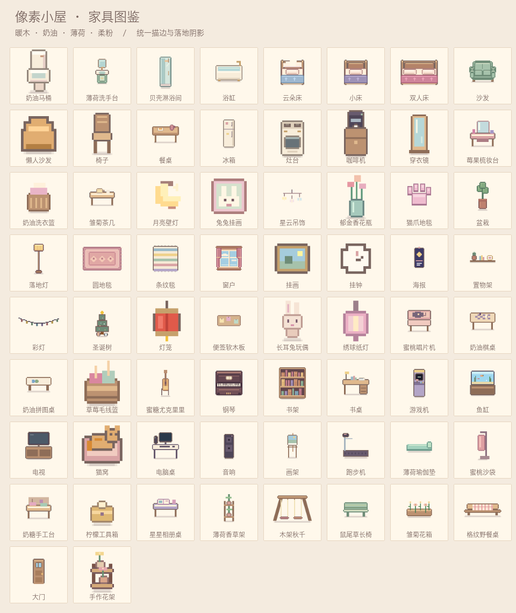

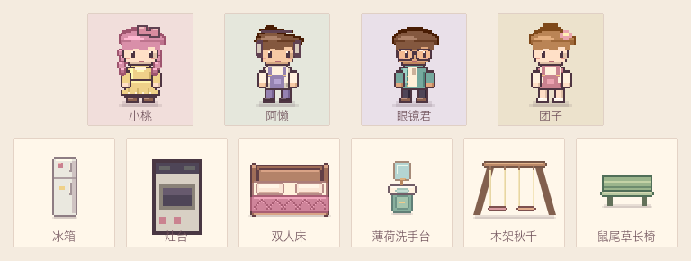

<table>
<tr>
<td width="50%">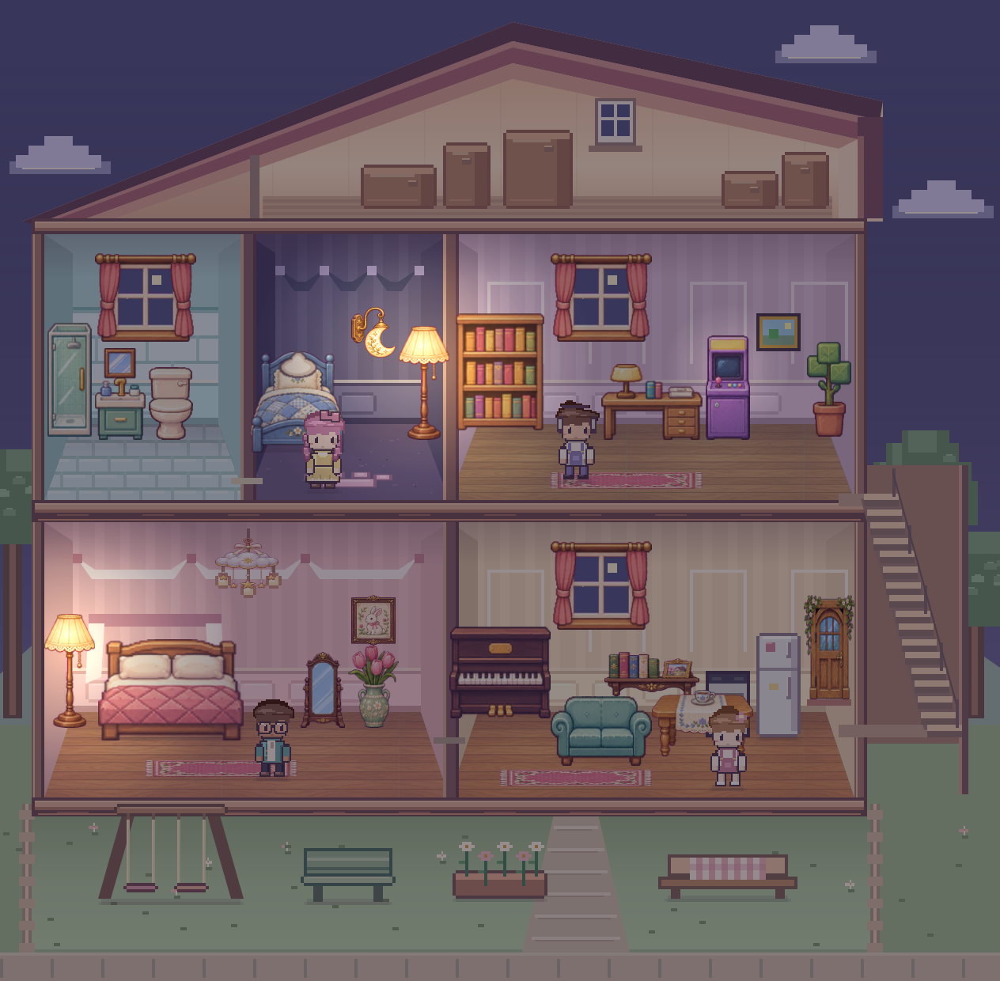<br><sub>夜晚 · 台灯和月亮壁灯亮起，住户回各自的卧室睡觉。</sub></td>
<td width="50%">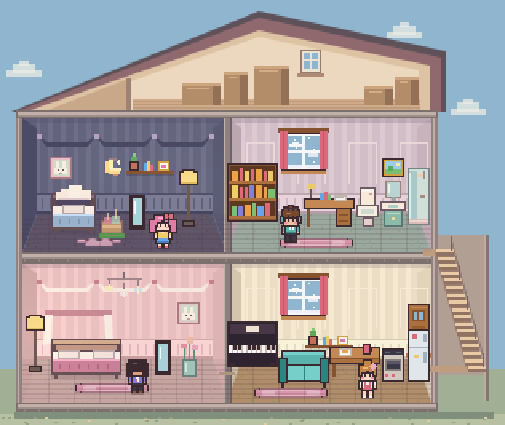<br><sub>布置 · 用马桶、洗手台和淋浴间搭出洗漱角。绿色网格表示可以放在这里。</sub></td>
</tr>
</table>

<table>
<tr>
<td width="50%"><br><sub>早期衣橱界面；新版穿搭与人物细节见上方图册。</sub></td>
<td width="50%"><br><sub>布置 · 点一下是确认意向，再点同一格才扣钱买下。</sub></td>
</tr>
</table>

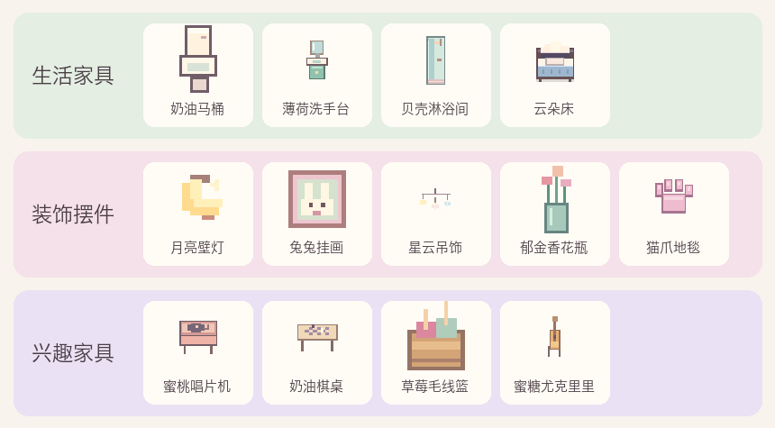

新家具举例：奶油马桶、薄荷洗手台、贝壳淋浴间、云朵床、月亮壁灯、兔兔挂画、猫爪地毯、蜜桃唱片机、奶油棋桌、草莓毛线篮、蜜糖尤克里里、莓果梳妆台、薄荷瑜伽垫、蜜桃沙袋……放好马桶后，如厕需求会随时间变化；两名住户一起下棋会增加友好度，并记入月报。

<details>
<summary>早期版本截图</summary>

[围观演奏](docs/party.png) · [家具商店](docs/shop.png) · [衣橱](docs/wardrobe.png) · [手机版](docs/mobile.png) · [旧版日报](docs/daily-paper.jpg)

</details>

---

## 🪑 家具图册

| 分类 | 新家具 | 住户会做什么 |
|---|---|---|
| 生活家具 | 奶油马桶、薄荷洗手台、贝壳淋浴间、云朵床 | 按需求如厕、洗手、淋浴和睡觉。放好马桶后，如厕需求会随时间变化。 |
| 装饰摆件 | 月亮壁灯、兔兔挂画、星云吊饰、郁金香花瓶、猫爪地毯 | 壁灯夜里发光，吊饰会轻轻摇动，猫爪地毯可以走过。 |
| 兴趣家具 | 蜜桃唱片机、奶油棋桌、草莓毛线篮、蜜糖尤克里里 | 听唱片、下棋、编织、弹琴。两名住户一起下棋会增加友好度，并记入月报。 |

新增家具还有莓果梳妆台、奶油洗衣篮、雏菊茶几、薄荷瑜伽垫、蜜桃沙袋、奶糖手工台、柠檬工具箱、星星相册桌、薄荷香草架、便签软木板、长耳兔玩偶和绣球纸灯。

新存档的仓库里有马桶、洗手台、猫爪地毯和毛线篮，可以直接拿出来试。布置时点家具卡选择物品，再点击房间里的格子。卡片会显示家具的用途、价格或库存。

---

## 🌦 季节、节日与月报

- **季节**：一年 12 个月，3–5 月春、6–8 月夏、9–11 月秋、12–2 月冬；天气每半天变一次，春夏秋会下雨、冬天会下雪
- **节日**：🧧 春节（2 月）拜年发红包、🥮 中秋（9 月）吃月饼赏月、🎄 圣诞（12 月）恋人和好朋友互送礼物，家里有圣诞树的话大家会围着它过节
- **📜 生活日志**：侧边栏按年月归档发生过的事（出门回家、工资房租、拥抱亲亲、表白、吃醋、撞破、分手……），保留最近 300 条，随存档保存
- **📰 小屋月报**：每月结束生成一期，最多三条故事，表白、分手、新住户和意外插曲优先。故事旁会显示相关住户当期的像素形象，头条小人会轻轻跳一下；点「事情的经过」可查看前因后果，还能复制本期、导出像素风 PNG 纪念卡。默认在下月 00:00 弹出（可以在设置里关掉自动打开；如果当时你正拖着小人或开着别的弹窗，月报会等你空闲了再弹，顶栏按钮也会提示“新一期到啦”）。「上一期 / 下一期」可以回看最近 30 期

## 🎉 朋友来访、派对与入住

朋友和邻居自动来访的机会较低。两次自动来访之间至少隔一个完整游戏月。手动邀请、办派对和约好的野餐照常可用。

- 傍晚，醒着且在家的住户有机会主动邀朋友来玩。「串门与派对」可以选一位住户做东，办茶点、音乐、游戏派对或院子野餐

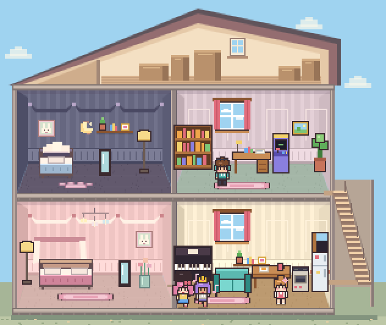

- 朋友会从门口走进客厅，有空的室友可以加入。玩得开心、和邀请人的关系够好时，朋友有机会留下入住申请；点「邀请新住户」可以接受，或另邀一位新朋友
- **🏡 隔壁麦麦家**：麦麦下午从面包店回来，有时来分面包，有时来借螺丝刀，下次见面会归还。爱招待人的住户会主动回赠点心。见过两个月后，麦麦可能约住户下个月去隔壁吃点东西。打开「隔壁麦麦家」可以看门廊小场景，也可以替受邀住户赴约。反复同桌才会成为饭搭子，来往够久也可能收到麦麦的入住申请
- **🌧 野餐下雨了**：画面下方会出现「搬进客厅」「改天再野餐」「撑伞继续」三个选项。过一会儿还没选，主人会按自己的性格决定。改期后还是同一位主人和访客，等天晴再开场。搬进客厅时，喜欢清静的住户和访客可能转去二楼书房，两人真正碰面后才会聊熟。这些插曲也会进月报

## 🧵 小角落、手作与雨天茶

- 窗边椅子、书架、雏菊茶几和钢琴会记住常来的住户。两个月都用过，就可能留下书、茶杯或曲谱。之后住户会更想回到那一件家具，挪位置也认得。相近的阅读角和双人茶几还能成为两个人常碰面的地方。
- 摆好奶糖手工台，在「住户与生活日志 → 小屋手记」选两位住户和一种花架颜色。两人走到手工台前才开始合作。做好后去「布置 → 纪念物」把花架摆出来。在生活模式点花架，可以查看是谁、哪月做的。收起后仍可再摆。
- 野餐遇雨时在二楼聊熟的两个人，以后可能在另一个雨天下午重聚。如果对方是访客，住户也会试着邀 TA 回来。两人都走到书房后，这次见面才会进入记忆与月报，入选月报时附两人的像素立绘。

## 🕰 离线、快照与时光回溯

- 顶部「离开时继续」可以随时开关。开启后，关页或切到后台再回来时，按正常速度补算离开的时间，最多一个游戏昼夜。关闭后，小屋在离开期间暂停。正式版和测试版分别记住你的选择
- 每月开始会自动留一份快照，最多保留 4 个月。月报弹窗底部的「时光回溯」可以回到其中任何一个月初（之后的事会重新发生）
- 进度自动保存在浏览器里；旧存档会自动升级，不会被丢弃
- 顶栏 **💾 存档备份与恢复** 可以下载 JSON 备份、查看选中文件里的年月与住户后再恢复，也可以迁移到另一台设备。正式版与测试版相互隔离；损坏、超大或来自更新版本的文件不会直接覆盖当前进度。
- 导入前会保存原来的小屋和月初快照，可点「撤销上次导入」。如果浏览器无法保存，顶栏会显示 ⚠️，可以先下载备份。导入旧文件不会补算文件导出以来的现实时间。

**小提示**

- 新游戏从 **1 年 1 月 00:00** 开始，一个完整昼夜推进一个月，正常速度约 6 分钟。用 ⏸、▶、⏩ 暂停、继续或快进
- 白天是轻快的芯片音乐，晚上会变成慢慢的摇篮曲

---

## 🏠 房间与旧存档

一楼是粉色卧室和客餐厅，二楼是深色卧室和书房。右侧楼梯间连接上下层，关门和楼层会影响目击及围观。可以把小人拎到另一层，也可以在两层摆家具和挂墙饰。

旧存档会保留住户、家具、关系、记忆和进度。挡住隔墙、门口或楼梯落点的家具会移到同层最近的空位。同层已满时收入仓库，并写入日志。旧存档的时间序号按月份换算，旧日报也会显示新年月。

---

## 🛠 开发

源码拆成了多个文件，方便修改：

```
├── index.html          正式版页面结构
├── dev.html            测试模式入口（由 build.py 生成）
├── style.css           界面样式，支持浅色 / 深色模式
├── js/                 游戏逻辑（按系统拆分）
│   ├── game.js         游戏状态、BFS 寻路、需求系统、性格 AI、昼夜时间
│   ├── view.js         渲染排序、光照、拖拽和摆放交互
│   ├── ui.js           住户列表、状态卡、布置面板、衣橱、主循环
│   ├── data.js         家具、性格、服装、墙纸地板等数据
│   ├── sprites.js      墙纸、地板、家具的像素绘制
│   ├── doll.js         小人的像素绘制、换色、朝向与动作
│   ├── audio.js        WebAudio 合成音效和背景音乐
│   ├── economy.js      家庭基金、商店、仓库、扩建
│   ├── social.js       人际关系、多人互动、围观、地下情与修罗场
│   ├── relationship-fallout.js 感情变故、心结、尴尬碰面与回避
│   ├── work.js         职业、作息、出门回家、收入与储蓄
│   ├── life-moments.js  生日仪式、三类本领、室友教学与小小里程碑
│   ├── house-life.js   月报和住户生活事件
│   ├── home-stories.js 性格心愿、家庭活动与长期相册
│   ├── home-care.js    留饭、便签、端碗吃饭和之后的道谢
│   ├── home-ui.js      小屋时光、相册和存档管理界面
│   ├── save-portability.js 存档导出、校验、预览恢复与撤销
│   ├── npc-memory.js   记忆写入、检索和长期归纳
│   ├── save-manager.js 浏览器快照保存与回退
│   └── …               季节、星座、社区、邻居、野餐、房间等模块
├── build.py            把以上文件合并成单个 HTML
├── pixel-dollhouse.html  打包好的成品
└── tests/              Node.js 回归测试
```

改完源码后重新打包：

```bash
python3 build.py
```

### 运行回归测试

在项目根目录使用支持内置测试运行器的 Node.js（本次验证使用 Node.js 22）运行：

```sh
node --test tests/*.test.cjs
```

新玩法回归包含真实寻路集合、三种活动和九种性格对白、活动打断、不知情或有心结的人物边界、心愿完成条件、读档续约不重复扣款、回忆形象快照、相册容量、存档校验与回滚，以及多个月的连续生活模拟。当前开发环境完成 Node 模拟和实际 Canvas 渲染验证；浏览器布局、真实手机交互与下载流程仍需实机验收，不能用模拟测试代替。

后续迭代与发布验收记录见 [开发记录](docs/ITERATION.md)。当前是持续打磨的可玩版本，尚未宣称完成商业上架验收。

测试覆盖入口脚本语法、主观视角与信息隔离、事件去重与序号缺口、结构化记忆合并、短期容量和来源保留、确信程度、20 次 JSON 保存读回，以及实际互动入口、家具分类、如厕和存档、双人棋桌、跨年换月和生日去重、拖放家具安排活动、家具购买二次确认、月报拖拽时延期。测试调用实际代码，并模拟所需的渲染、计时器或其他外部依赖。

### 当前边界

- 这是基础记忆版本。Working Memory 继续使用既有角色运行状态，尚未实现完整的当前行动恢复
- 长期记忆超过 50 条时按重要程度和时间截断，人生摘要也有上限，尚不能保证所有重要人生经历永久保留
- 事件记录支持记忆来源追踪和去重，尚未实现世界状态的事件重放
- 已实现 LocalStorage 主档、上一有效快照回退、v1→v2 版本迁移、最近 4 个月的月初快照，以及可校验、可撤销的 JSON 导入导出。IndexedDB 尚未实现
- JSON 往返测试验证结构化数据保留，浏览器关闭重开、地图与物品恢复、完整游玩流程仍待端到端验收

---

<div align="center">
<sub>用像素美术、Canvas 和 WebAudio 搭起来的小房子 🏡</sub>
</div>


 · [小屋夜景](docs/art-night.png)
