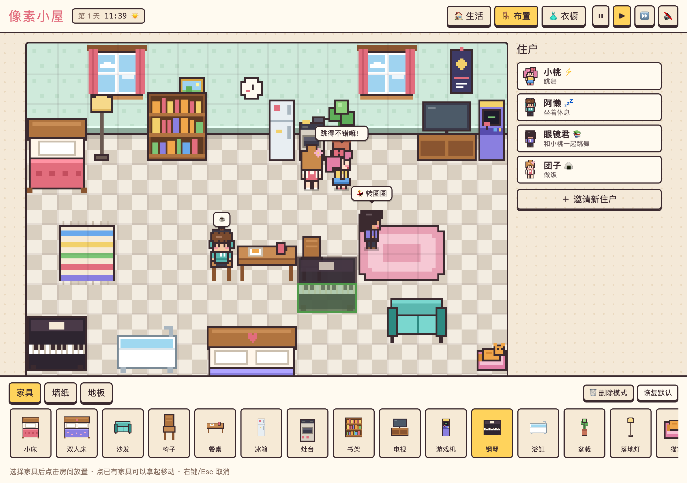

<div align="center">

# 🏠 像素小屋 · DollHouse

**一个可以放在口袋里的像素小人之家**

小人们会在房子里自己生活：吃饭、睡觉、弹琴、打游戏、聊天、交朋友，甚至谈恋爱。
你负责布置房间、给他们换衣服，偶尔把谁拎起来换个地方。


<sub>☝️ 小桃弹起了钢琴，大家陆续围过来听，有人跟着跳起舞</sub>

<br>


</div>

---

## ✨ 零素材：一切都是代码现场画出来的

游戏里**没有一张图片、一个 3D 模型、一段音频**。

- 🎨 **画面**：墙纸、地板、21 种家具，还有每个小人的发型、衣服、配饰，都是打开网页后用 Canvas 一个像素一个像素画出来的
- 🔊 **声音**：放家具的"咚"、吃零食的"咔嚓"、弹琴的音符、猫叫声和背景音乐，全部用 WebAudio 振荡器和噪声现场合成
- 🌗 **光影**：天色随时间变化，入夜后房间变暗，台灯、电视、游戏机会发出暖光

整个游戏打包后是一个约 100KB 的 HTML 文件。双击就能玩，不用联网，也不用安装任何东西。

> README 里的截图和动图只是为了展示效果，是用无头浏览器对游戏画面截的屏，游戏本身用不到它们。

---

## 🎮 玩法一览

<table>
<tr>
<td width="50%" valign="top">

### 🏠 生活
小人有**精力、饱腹、快乐、社交**四项需求，会根据需求和性格自己决定下一步做什么。

- 点击小人：查看状态卡、摸摸头
- 按住拖动：把小人**拎起来**放到别处
- 选中小人后点家具：让 TA 去用那件家具

</td>
<td width="50%" valign="top">

### 🪑 布置
- 21 种家具，点一下就能放进房间，包括可以睡两个人的双人床
- 点已有家具可以**拿起来移动**
- 8 种墙纸、6 种地板随意搭配
- 放好的家具，小人马上就会去用

</td>
</tr>
<tr>
<td valign="top">

### 👗 衣橱
- 5 种肤色 · 6 种发型 · 10 种发色
- 6 种上衣 · 3 种下装 · 12 种衣服颜色
- 7 种配饰：鸭舌帽、蝴蝶结、眼镜、耳机、猫耳、小花、王冠……
- 一键 🎲 随机搭配，可以改名、改性格

</td>
<td valign="top">

### 💞 人际关系
- 每对小人之间都有 **🤝 友好度** 和 **💗 恋爱度**
- 关系会从 陌生 → 认识 → 朋友 → 好友 → 挚友 慢慢发展
- 合得来的会心动、表白，表白成功就成为 **💕 恋人**
- 恋人晚上会叫对方一起睡 **双人床**，睡着时还会冒 💕
- 合不来的会吵架，严重时会闹翻，恋人也可能分手

</td>
</tr>
</table>

---

## 📸 截图

<table>
<tr>
<td width="50%"><br><sub><b>白天</b> · 选中小人后能看到需求和人际关系，小桃和眼镜君已经是恋人了</sub></td>
<td width="50%"><br><sub><b>围观</b> · 有人弹琴时，其他人会凑过来听，演奏者会说"谢谢捧场"</sub></td>
</tr>
<tr>
<td colspan="2"><br><sub><b>同床共枕</b> · 小桃先躺上双人床，叫恋人眼镜君一起睡，两人睡着时还会冒 💕</sub></td>
</tr>
<tr>
<td><br><sub><b>夜晚</b> · 星空墙纸配胡桃木地板，台灯点亮，有人已经睡着了</sub></td>
<td><br><sub><b>布置</b> · 薄荷墙纸配格子地板，绿框表示这里可以放钢琴</sub></td>
</tr>
<tr>
<td><br><sub><b>衣橱</b> · 换装时预览的小人会原地走路</sub></td>
<td align="center"><br><sub><b>手机</b> · 支持触屏，手指按住就能拎起小人</sub></td>
</tr>
</table>

---

## 🧸 五种性格

| 性格 | 特点 | 喜欢 |
|:---:|---|---|
| ⚡ **元气** | 停不下来，快乐掉得快，走路最快 | 打游戏、跳舞、弹琴、到处逛 |
| 💤 **懒懒** | 能躺着绝不坐着，精力掉得快 | 睡觉、窝沙发、看电视、泡澡 |
| 📚 **书虫** | 安静，不太需要社交 | 看书、弹琴、浇花 |
| 🍙 **吃货** | 饿得特别快，满脑子都是下一顿 | 翻冰箱、做饭 |
| 💬 **社牛** | 一会儿不说话就寂寞 | 找人聊天、撸猫、跳舞 |

## 💬 小人之间会发生的事

| 互动 | 什么时候发生 | 效果 |
|---|---|---|
| 聊天 / 打闹 | 随时 | 友好度上升；熟了以后会慢慢心动 |
| 🤗 抱抱 | 友好度够高 | 友好度和恋爱度都上升 |
| 💌 表白 | 心动了，而且双方都单身 | 成功会更喜欢对方，恋爱度够高就在一起；失败会有点难过 |
| 💋 亲亲 | 恋人之间 | 恋爱度上升 |
| 🛏 一起睡 | 恋人中的一个躺上双人床，另一个也困了或者已经是晚上 | 会叫对方来睡另一边，睡着时恋爱度慢慢上升；双人床只和恋人分享 |
| 💢 吵架 | 合不来，或者心情很差 | 友好度和恋爱度下降，严重时闹翻或分手 |
| 🎵 围观 | 有人在弹琴、跳舞、打游戏、看电视、做饭、看书 | 凑过去听、一起跳、加油、蹭饭……大家都会更开心 |

关系每次跨过门槛（成为好友、在一起、闹翻、分手），屏幕下方都会弹出提示。

---

## 🚀 怎么玩

**直接玩**：下载 [`pixel-dollhouse.html`](pixel-dollhouse.html)，双击用浏览器打开就行。

```bash
git clone git@github.com:AubreyKuang/DollHouse.git
open DollHouse/pixel-dollhouse.html
```

**小提示**
- 声音默认关闭，点右上角 🔇 打开。白天是轻快的芯片音乐，晚上会变成慢慢的摇篮曲
- ⏸ ▶ ⏩ 可以暂停或快进时间。游戏里一天大约是现实中的 6 分钟
- 进度自动保存在浏览器里，关掉再打开还是原来的房间

---

## 🛠 开发

源码拆成了几个文件，方便修改：

```
├── index.html          页面结构（开发时直接打开它）
├── style.css           界面样式，支持浅色 / 深色模式
├── js/
│   ├── data.js         家具、性格、服装、墙纸地板等数据
│   ├── sprites.js      墙纸、地板、家具的像素绘制
│   ├── doll.js         小人的像素绘制：发型、衣服、配饰、朝向、动画
│   ├── audio.js        WebAudio 合成音效和背景音乐
│   ├── game.js         游戏状态、BFS 寻路、需求系统、性格 AI、昼夜时间
│   ├── social.js       人际关系、多人互动、围观
│   ├── view.js         渲染排序、光照、拖拽和摆放交互
│   └── ui.js           住户列表、状态卡、布置面板、衣橱、主循环
├── build.py            把以上文件合并成单个 HTML
└── pixel-dollhouse.html  打包好的成品
```

改完源码后重新打包：

```bash
python3 build.py
```

---

<div align="center">
<sub>用 Canvas 和 WebAudio 一个像素、一个音符地拼出来的小房子 🏡</sub>
</div>
